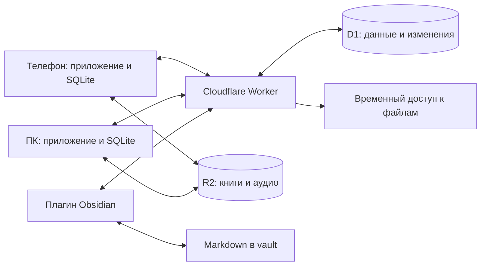

# PepeHub: самостоятельное приложение для чтения и аудиокниг

Предложение от 11 сентября 2026 года. Это проект архитектуры, а не реализованное приложение. Код существующего плагина изучен выборочно; сборка, нагрузочные и аппаратные проверки ещё не выполнялись.

## 1. Продукт и исходные допущения

Приложение на телефоне и ПК хранит библиотеку, открывает книги, воспроизводит аудиокниги, записывает сессии и синхронизирует данные через Cloudflare. Obsidian получает читаемые карточки, историю и заметки; выбранные поля можно редактировать обратно.

До уточнения платформ рабочее допущение — Android и Windows в первой версии, iOS позже. До уточнения направления обмена закладываем двусторонний протокол, но первый этап интеграции — экспорт и проверка сохранности Markdown. Начинаем с личного использования, предусматривая разделение данных по пользователям.

Главный принцип: каждое устройство работает с локальными данными. Интернет, включённый ПК и запущенный Obsidian не нужны для чтения уже скачанных книг и сохранения действий. Cloudflare передаёт изменения между устройствами и хранит облачную копию.

## 2. Что уже есть в obsidian-habit-timer-main

Изучены исходники в `L:/Obs/MySecondBrain/.obsidian/plugins/obsidian-habit-timer-main`:

- `package.json`: TypeScript, Svelte 5, Obsidian API, Vitest.
- `cloudflare-companion/README.md`: Worker, D1, Telegram Mini App, события и снимки данных.
- `src/types.ts` и `src/library/property-schema.ts`: коллекции, статусы, авторы, серии, единицы прогресса и алиасы YAML-полей.
- `src/services/cloudflare-companion-service.ts`: получение событий, применение в Obsidian, сохранение курсора, подтверждение и отправка снимка; история привычек ограничивается последними 120 днями.
- `cloudflare-companion/src/db.ts`: выборка событий по sequence с лимитом 250 и подтверждение на уровне profile_id.
- `cloudflare-companion/src/types.ts`: библиотека привязана к пути заметки; есть события с event_id и sequence.

Сохраняем предметную модель, совместимость полей, полезные алгоритмы статистики, примеры и тестовые сценарии. TypeScript-код можно частично использовать в Worker и новом мосте Obsidian. При выборе Flutter интерфейс и клиентская логика потребуют переноса на Dart.

Для нескольких самостоятельных клиентов нужно изменить протокол: отдельные курсоры устройств, стабильные ID сущностей, контроль конкурентных изменений и устойчивая дедупликация. Схему подтверждений для одного профиля нельзя автоматически считать готовой для нескольких потребителей. Запись Markdown и запись применённого event_id также не составляют одну транзакцию: восстановление после сбоя нужно проектировать отдельно.

Старые пути заметок сохраняем как миграционные ссылки, а не как постоянную идентичность книги. Новую службу развиваем отдельно от работающего Companion, затем подключаем адаптер миграции.

## 3. Технологии

| Часть | Предложение | Причина и оговорки |
| --- | --- | --- |
| Приложение | Flutter / Dart | Общий интерфейс и клиентская логика для телефона и ПК. Официально поддерживает Android, iOS и Windows; отдельные библиотеки проверяются по платформам. |
| Локальная база | SQLite + Drift | Транзакции, индексы, миграции, локальные запросы. Тяжёлую работу базы вынести из UI isolate. Drift сам по себе не предоставляет облачную синхронизацию. |
| API | Cloudflare Workers / TypeScript | Авторизация, валидация, приём операций и получение изменений. |
| Метаданные и журнал | Cloudflare D1 | Карточки, сессии, позиции, версии, курсоры устройств; без бинарных книг. |
| Файлы | Закрытый Cloudflare R2 | EPUB, аудио, обложки; загрузка и скачивание с ограниченным по времени доступом. |
| Obsidian | Небольшой плагин на TypeScript | Обмен через общий API и безопасное обновление выбранных Markdown-файлов. |
| EPUB на телефоне | Readium через проверенный адаптер | Проверить конкретную обёртку, производительность, выделения и восстановление позиции. |
| EPUB на Windows | Прототип Readium Web в локальном WebView | Это отдельная интеграция, а не готовая функция flutter_readium. Нужны локальная раздача ресурсов и проверка совместимости locators. |
| Аудио | just_audio + audio_service на телефоне | Windows требует отдельного backend и проверки системных медиакнопок; проверить media_kit-вариант. |

Flutter — предварительный выбор после проверки документации, а не обещание лучшей скорости. Окончательно закрепить его после работающего EPUB и фонового аудио на целевых устройствах.

Альтернатива — Tauri 2 + Svelte + TypeScript: лучше сохраняет навыки и часть существующего UI. Потребуется Rust и платформенная интеграция аудио/фоновых задач. Если повторное использование Svelte окажется главным приоритетом, оценить этот вариант на таком же техническом прототипе. Сам по себе маленький установщик не доказывает скорость чтения или надёжность плеера.

Документация: [Flutter](https://docs.flutter.dev/reference/supported-platforms), [Drift](https://drift.simonbinder.eu/setup/), [Drift isolates](https://drift.simonbinder.eu/isolates/), [Tauri](https://tauri.app/start/).

Для чтения и аудио: [flutter_readium — платформенные ограничения](https://pub.dev/packages/flutter_readium), [Readium Web](https://readium.org/web/), [just_audio — Windows backend](https://pub.dev/packages/just_audio), [audio_service](https://pub.dev/packages/audio_service).

## 4. Поток данных



После паузы аудиокниги телефон сохраняет позицию и сессию локально. При наличии сети отправляет изменения. ПК получает их и предлагает продолжить. Плагин Obsidian при следующем запуске/синхронизации обновляет карточку и журнал.

Файлы не проходят через D1. Для больших аудиокниг нужны возобновляемая multipart-загрузка и воспроизведение с HTTP Range; ответ медиа-шлюза должен корректно передавать Content-Type, Content-Length, Content-Range и статус 206. При истечении временной ссылки плеер получает новую и продолжает с текущей позиции. См. [R2 presigned URLs](https://developers.cloudflare.com/r2/api/s3/presigned-urls/) и [R2 API](https://developers.cloudflare.com/r2/api/workers/workers-api-reference/).

## 5. Модель данных

- `library_items`: стабильный UUID, пользователь, тип, название, авторы, коллекция, статус, рейтинг, версия.
- `assets`: ID файла, книга, хеш SHA-256, размер, MIME, формат, вариант издания, облачный ключ; связь с локальным файлом хранится отдельно на устройстве.
- `audio_tracks`: порядок файлов, длительность, главы. Одна аудиокнига может состоять из множества файлов.
- `positions`: пользователь, книга, конкретное издание/asset, тип позиции, версия и устройство.
- `sessions`: ID, тип активности, начало/окончание, активная длительность, источник, начальная и конечная позиции.
- `annotations`: ID, книга/издание, locator, цитата, контекст, комментарий, версия.
- `devices`, `outbox`, `change_log`, `device_cursors`, `tombstones`: доставка, повторные попытки, удаления и восстановление.
- `obsidian_links`: ID сущности, vault, текущий путь, базовая версия синхронизированных полей и миграционное соответствие.

Книга и её EPUB/аудиоверсия связаны, но имеют разные позиции. Автоматическое соответствие «страница → минута аудио» не обещаем: ему нужна дополнительная разметка или отдельное выравнивание текста.

EPUB хранит locator к ресурсу и месту текста с контекстом и версией файла. Номер экранной страницы зависит от шрифта и размера окна. PDF хранит номер страницы и координаты. Аудио хранит track ID и позицию в миллисекундах. Для UI отдельно рассчитываются проценты.

## 6. Правила синхронизации

1. Изменение пользовательских данных и операция в outbox записываются одной локальной транзакцией.
2. Операция содержит UUID, device_id, локальный порядковый номер, entity_id, base_revision, тип, payload и schema_version. Время устройства нужно для истории, но не является единственным критерием конфликта.
3. Worker проверяет пользователя, права на сущность, формат, размеры и версию. В одной серверной транзакции фиксирует уникальный operation_id, изменение сущности и запись в журнале с серверной sequence. Повторная доставка возвращает прежний результат.
4. Клиент получает журнал страницами после своего курсора. Применяет страницу и продвигает курсор одной локальной транзакцией. Неподтверждённые локальные изменения при этом сохраняются и согласуются с удалённой версией.
5. Ошибка сети оставляет outbox на диске; повторные попытки используют задержку с jitter. Пользователь видит состояние синхронизации и может повторить её вручную.
6. Отдельный курсор каждого устройства. Новый клиент получает согласованный снимок с границей sequence, затем изменения после этой границы. Если журнал уже очищен, клиент получает новый снимок с сохранением своего outbox.
7. Удаления — tombstones. Срок хранения, отключение давно неактивных устройств и повторная полная синхронизация задаются явно. Очистка не должна позволять старому офлайн-клиенту восстановить удалённую книгу.

Разрешение конфликтов зависит от данных:

| Данные | Правило |
| --- | --- |
| Сессии | Независимые ID, объединение записей. Повторная доставка не увеличивает статистику. Редактирование/удаление сессии — версионированная операция. |
| Позиция | Последовательные обновления с одного устройства схлопываются. Конкурентные позиции сохраняются как варианты; предложить продолжить с нужного устройства. Нельзя всегда брать максимальный процент: пользователь может перечитывать. |
| Название, статус, рейтинг | Сливать изменения разных полей относительно общей базовой версии. Для одновременной правки одного поля сохранить конфликт и обе версии. |
| Цитаты и комментарии | Стабильные ID; независимые записи объединяются, конфликт одного комментария сохраняется. |
| Произвольный Markdown | Текст пользователя принадлежит Obsidian; полноценное совместное редактирование всего документа не входит в первую версию. |

Не отправлять каждую секунду плеера. Локальные checkpoints примерно раз в 5–15 секунд и при pause/seek/смене трека; на сервер — объединённые обновления с ограничением частоты. Точные интервалы выбрать измерениями. При аварийном завершении возможна потеря времени после последнего checkpoint; это должно быть измерено и ограничено.

## 7. Интеграция с Obsidian

В vault сохраняются обычные Markdown-карточки, цитаты и журналы. EPUB/аудио доступны как облачные объекты и локальные загрузки приложения; копирование самих файлов в vault — отдельная настройка. Так пользователь может хранить библиотеку карточек без обязательного дублирования всех гигабайтов аудио.

Рекомендуемая начальная структура, настраиваемая под существующие папки:

```text
Library/<название книги>.md
Reading/Logs/2026-09-11.md
Reading/Quotes/<название книги>.md
```

Каждая карточка получает `pepehub_id`; привычные названия свойств сохраняются через алиасы старого плагина. Переименование файла меняет путь в mapping, но не ID книги.

Мост обновляет только согласованные YAML-поля и помеченные блоки журнала. Логи имеют стабильные session ID, поэтому повторный экспорт обновляет или пропускает запись. Чужие свойства, текст, ссылки и секции сохраняются. Для Markdown использовать `Vault.process()`, для свойств — `FileManager.processFrontMatter()`. См. [Obsidian Vault API](https://docs.obsidian.md/Plugins/Vault).

Запись нескольких Markdown-файлов не атомарна. Нужен журнал незавершённого применения, идентификаторы записей в файлах, повторяемые операции и восстановление после перезапуска. Перед импортом ручных правок сравнивать с сохранённой базовой версией, чтобы экспорт не превращался в новое пользовательское изменение по кругу.

На первом этапе один выбранный экземпляр Obsidian пишет управляемые блоки. Если весь vault уже синхронизируется другой программой, именно она распространяет эти Markdown-файлы. Одновременный запуск мостов на нескольких копиях vault разрешать только после проверки конфликтов: отдельные device ID, защита от повторного импорта и согласование владельца экспорта обязательны.

Самостоятельные приложения обмениваются данными через Cloudflare при выключенном ПК. Закрытый Obsidian не выполняет плагин, поэтому локальные Markdown обновятся при следующем запуске. Мост обновляет выбранные данные, а не синхронизирует весь vault. Для записи на ПК при закрытом Obsidian позже возможен фоновый агент с единственным владельцем записи; это дополнительная функция.

## 8. Аудио и достоверные логи

Плеер должен поддерживать работу при погашенном экране, медиакнопки, гарнитуру, скорость, главы, таймер сна, паузу при звонке и восстановление позиции. На Android фоновое проигрывание интегрируется с MediaSessionService; на iOS используются разрешённые режимы аудио. Это отдельная проверка на реальных устройствах, а не свойство интерфейсного фреймворка. См. [Android](https://developer.android.com/media/media3/session/background-playback), [Apple](https://developer.apple.com/documentation/xcode/configuring-background-execution-modes).

Учитываем реальное время воспроизведения отдельно от пройденного времени записи: 30 минут на скорости 2× дают 30 минут слушания и примерно 60 минут контента при непрерывном воспроизведении. Паузы и буферизация не считаются. Перемотка вперёд не является прослушиванием. Храним интервалы для расчёта уникального покрытия; повторное слушание учитывается во времени, но не удваивает уникальное покрытие.

Чтение: явная сессия или автоматический режим с настраиваемым порогом бездействия; сворачивание и блокировка останавливают учёт чтения. Автоматический режим — оценка активности, а не доказательство прочтения. Нужна ручная коррекция. Сессии через полночь разделяются для отчётов с учётом сохранённого часового пояса.

Произвольную фоновую синхронизацию мобильная ОС может откладывать. Основные точки обмена — запуск/возврат, восстановление сети, пауза и завершение сессии. На iOS время фоновых задач выбирает система: [Apple Background Tasks](https://developer.apple.com/documentation/BackgroundTasks/choosing-background-strategies-for-your-app).

## 9. Скорость и масштабирование

Интерфейс читает локальную SQLite; индексы и постраничная загрузка ограничивают объём запросов. Обложки уменьшаются и кешируются. Распаковка, хеширование, индексация EPUB и большие импорты выполняются вне UI. В память загружается текущая часть книги, а не вся медиатека. Статистика использует агрегаты, обновляемые по изменениям сессий.

Начальные цели для проверки в release-сборках на согласованных устройствах, не достигнутые показатели:

- библиотека из 10 000 карточек и 100 000 сессий: полезный экран холодного запуска до 2 секунд;
- локальный поиск: p95 до 150 мс после завершения индексации;
- локальная EPUB обычного размера: открытие до 2 секунд; большие и повреждённые файлы измеряются отдельно;
- изменения метаданных между двумя активными онлайн-клиентами: p95 до 5 секунд при нормальной сети;
- открытие библиотеки и чтение скачанной книги не требуют ответа сервера.

На старте — один модульный backend с доменами Library, Reader, Audio, Activity, Sync и Obsidian. Для новых типов занятий добавляем типизированные расширения с версией схемы, сохраняя общее ядро сессий и синхронизации. Пользовательская система плагинов и микросервисы пока не нужны.

С первого дня owner_id проверяется сервером во всех запросах. Далее измеряются размер журнала, задержки, число строк чтения/записи и стоимость. При росте — разделение пользователей по D1-базам и отдельные очереди тяжёлых заданий. У одной D1 есть предел размера: сейчас 10 GB на платном плане и 500 MB на бесплатном; она не растёт бесконечно. См. [лимиты D1](https://developers.cloudflare.com/d1/platform/limits/).

## 10. Доступ, файлы и восстановление

Для личной версии — регистрация устройств с отдельными отзываемыми ключами и ограниченными правами. Для нескольких пользователей — стандартный вход через провайдера идентификации и изоляция владельцев. Cloudflare API token и R2 S3 secret никогда не выдаются приложению. Локальные ключи хранятся в системном защищённом хранилище, а не в синхронизируемой заметке.

R2 закрыт; временные ссылки выдаются после проверки владельца. Загрузка имеет квоту, допустимый размер, состояние pending/ready и подтверждение завершения. Хеш определяет конкретную версию файла; незавершённые загрузки очищаются. EPUB рассматривается как недоверенный ZIP/HTML: лимит распаковки, защита от выхода за каталог, запрет произвольных скриптов и доступа к мосту приложения.

Синхронизация и резервная копия решают разные задачи. Нужны экспорт JSON/Markdown, резервные снимки метаданных и проверка восстановления файлов. Шифрование транспорта и серверного хранилища не означает сквозное шифрование. Если оно обязательно, формат операций, поиск, управление ключами и доступ к аудиофрагментам проектируются с этим требованием до реализации синхронизации.

По текущему тарифу R2 Standard: 10 GB-month бесплатно, далее $0.015/GB-month; операции оплачиваются отдельно, исходящий трафик R2 бесплатный. При стабильных 100 GB стоимость только хранения примерно $1.35/месяц сверх бесплатного объёма. Workers, D1, операции, резервные копии и налоги в эту оценку не входят. См. [тариф R2](https://developers.cloudflare.com/r2/pricing/).

## 11. Порядок реализации и критерии готовности

### Этап 0 — проверка основных рисков

Минимальное приложение на Android и Windows открывает один EPUB, сохраняет и восстанавливает одинаковое место текста после изменения шрифта. Воспроизводит MP3/M4B локально и через Range, поддерживает перемотку. На телефоне аудио работает при блокировке экрана, после паузы/звонка восстанавливается корректно. По результату выбираются библиотеки и фиксируется стек.

### Этап 1 — самостоятельная локальная версия

Библиотека, импорт EPUB и аудио, поиск, чтение, плеер, закладки, сессии, простая статистика, очередь загрузок и офлайн-режим. Реальный рабочий сценарий без Obsidian и аккаунта. PDF/FB2, TTS, курсы и задачи — следующие модули после основного сценария.

### Этап 2 — сквозной сценарий с Cloudflare и Obsidian

Отзыв ключа устройства; загрузка файла в R2; продолжение книги на ПК после телефона; сессии на обоих клиентах; читаемая карточка и журнал в Obsidian; видимый статус синхронизации. Плагин экспортирует данные повторяемо и восстанавливается после сбоя. Это минимальная версия, выполняющая главную идею продукта.

### Этап 3 — двусторонние правки и миграция

Импорт существующих карточек и истории с алиасами YAML, отчётом предварительного просмотра и стабильными миграционными ID. Повторный импорт не создаёт дубликаты; неоднозначные совпадения не объединяются автоматически. Сверка количества книг, длительностей и дат на копии vault. Затем обратная синхронизация разрешённых полей и заметок с показом конфликтов.

### Этап 4 — расширение

PDF/FB2, TTS, дополнительные типы деятельности, привычки и задачи, Telegram как дополнительный клиент, iOS при необходимости. Каждая возможность использует общие ID, Activity и Sync, но сохраняет собственные правила прогресса.

Обязательные сценарии перед использованием с основной библиотекой:

1. Оба устройства офлайн меняют одну книгу; после подключения независимые сессии сохранены, конфликт позиции виден.
2. Повторная отправка одной операции и потерянный ответ сервера не удваивают лог.
3. Сбой после записи Markdown, но до сохранения курсора, не создаёт повторную строку после перезапуска.
4. Старое устройство после удаления книги не восстанавливает её самопроизвольно.
5. Переименование заметки сохраняет связь с книгой; пользовательский текст остаётся целым.
6. Истёкшая ссылка и обрыв загрузки восстанавливаются с текущего места, с проверкой версии файла.
7. Ускорение, пауза, перемотка и переход через полночь дают корректную статистику.
8. Новое устройство восстанавливает библиотеку после очистки журнала; резервная копия действительно читается.

## 12. Предлагаемая структура репозитория

```text
apps/pepehub/                 Flutter: Android и Windows
services/sync-worker/         Cloudflare Worker и миграции D1
integrations/obsidian/        Плагин-мост
contracts/                   Схемы API, версии, общие примеры
migration/                   Импорт из Habit Timer
fixtures/                    Разрешённые тестовые книги и анонимные данные
docs/                        Решения, протокол и результаты измерений
```

Не копировать пользовательский vault, токены, настройки Companion или личные книги в репозиторий. Общие JSON fixtures проверяют, что Dart и TypeScript одинаково понимают протокол.

## 13. Что ещё уточнить

- Телефон Android или iPhone; какие ещё ОС нужны в первой версии.
- Какие поля и логи должны редактироваться в Obsidian и возвращаться в приложение.
- Требуется ли хранить в vault сами EPUB/аудиофайлы или достаточно карточек, журналов и ссылок.
- Главные реальные форматы и примерный объём библиотеки.
- Личное использование или выпуск для других пользователей; обязательность сквозного шифрования.

Эти ответы уточняют объём работ. Они не меняют базовое разделение: локальное приложение, синхронизация данных, хранение файлов и интеграция с Markdown.
