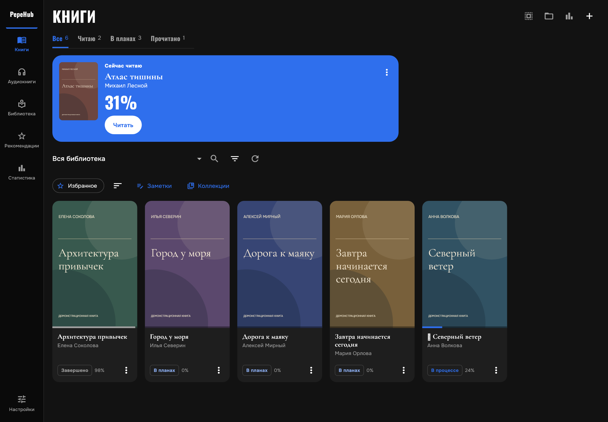
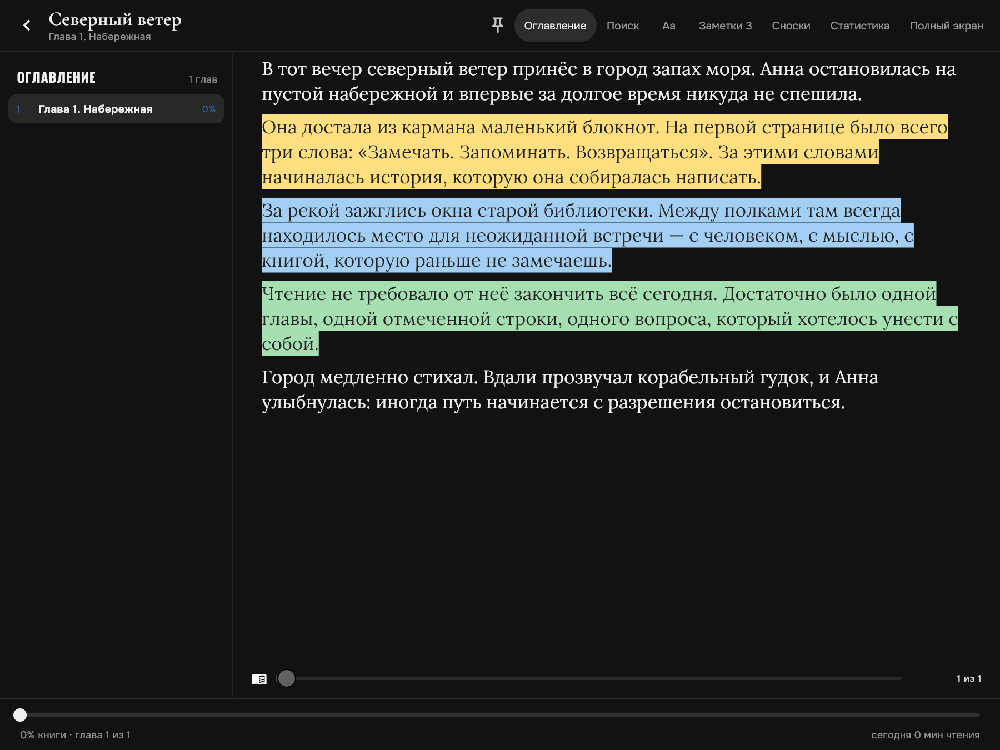
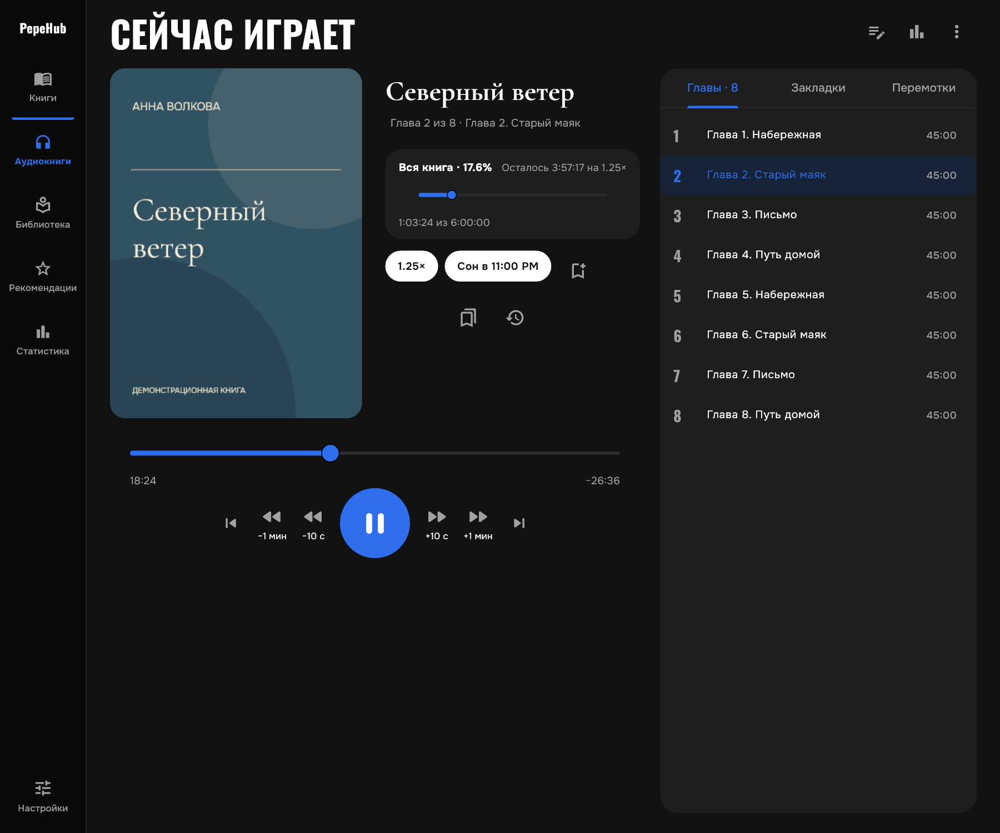
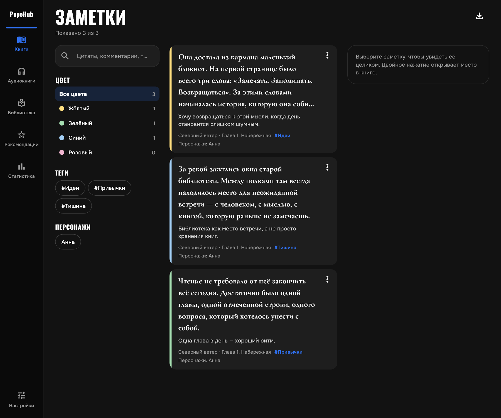
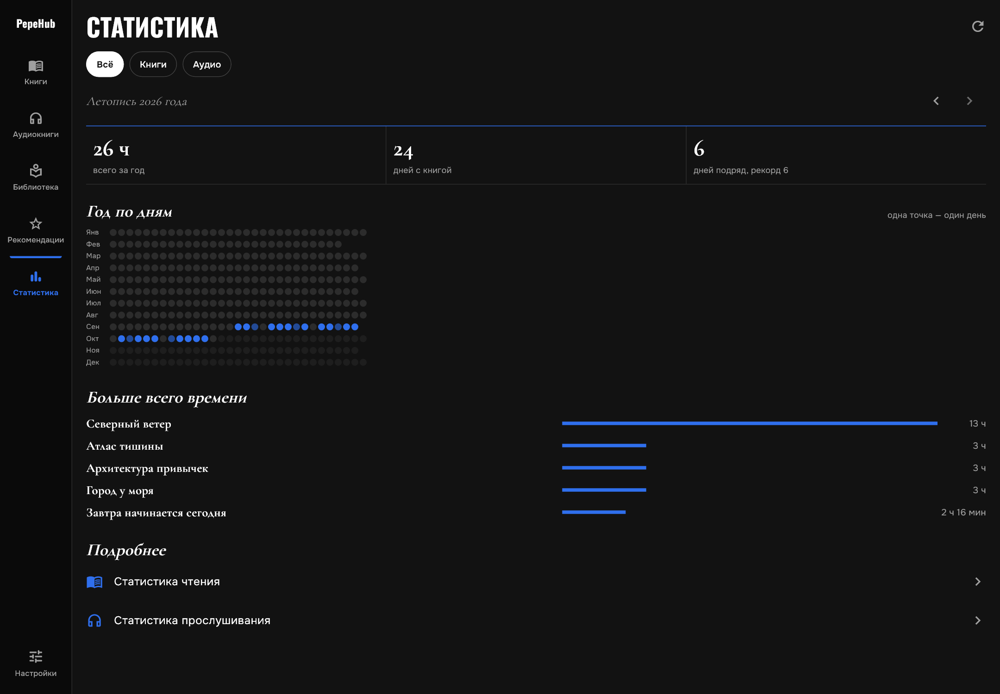
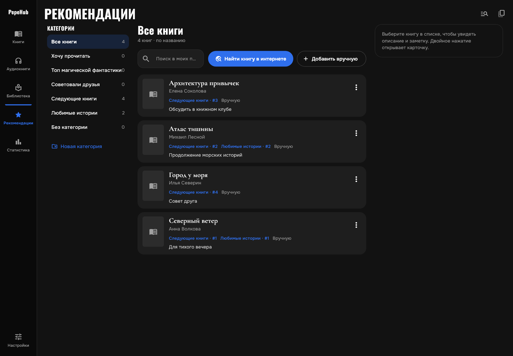
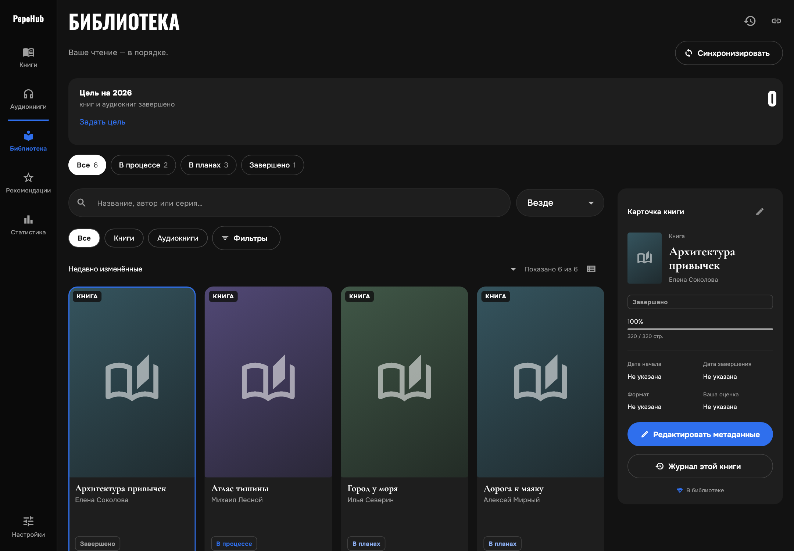
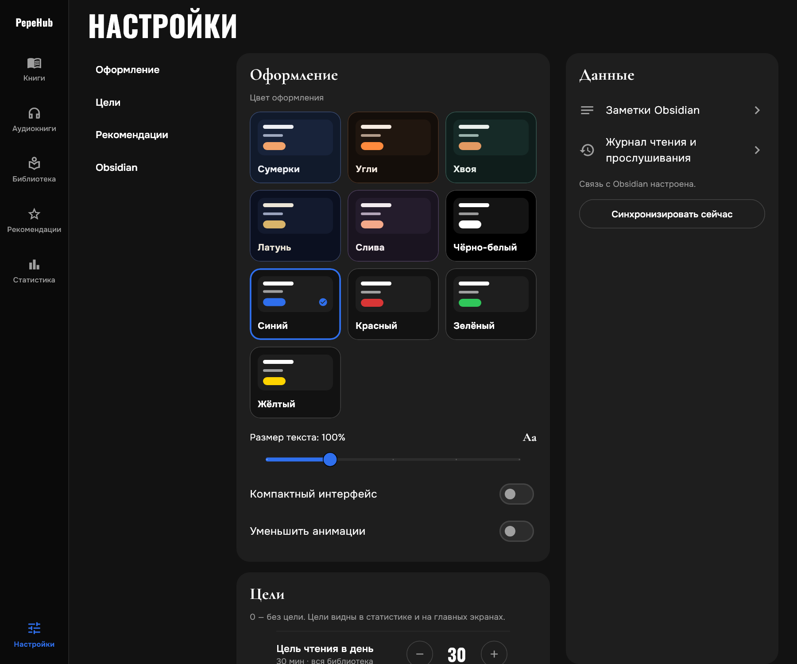
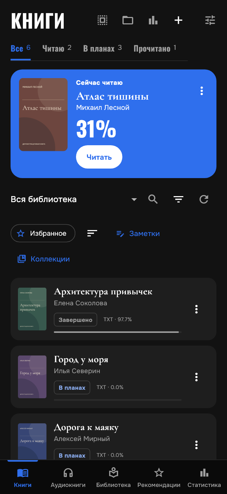

# PepeHub

**Книги, аудиокниги, цитаты и история чтения — в одном приложении.**

PepeHub — личная библиотека для **Windows и Android**. Читайте свои книги, слушайте аудио из подключённых папок, сохраняйте мысли и наблюдайте за привычкой читать. Основные возможности работают без аккаунта и интернета; обмен с Obsidian и поиск сведений о книгах подключаются отдельно.

[Скачать](#скачать-и-установить) · [Скриншоты](#скриншоты) · [Возможности](#возможности) · [Obsidian](#обмен-с-obsidian) · [Сборка](#для-разработчиков)

## Скачать и установить

Текущий выпуск — **0.19.0+49**. [Описание изменений](docs/RELEASE_0190.md) · [GitHub Releases](https://github.com/IshchenkoEvgeniy/PepeHub/releases).

| Платформа | Скачать | Установка |
|---|---|---|
| **Windows x64** | [ZIP 0.19.0](https://github.com/IshchenkoEvgeniy/PepeHub/releases/download/v0.19.0/PepeHub-0.19.0-windows-x64.zip) | Распакуйте **весь архив** в отдельную папку и запустите `pepehub.exe`. DLL и каталог `data` должны оставаться рядом. |
| **Android ARM64, 7.0+** | [APK 0.19.0](https://github.com/IshchenkoEvgeniy/PepeHub/releases/download/v0.19.0/PepeHub-0.19.0-android-arm64-test.apk) | Откройте APK и разрешите установку из выбранного источника, если Android запросит. Подпись совпадает с предыдущими выпусками. |

В релизе есть файлы **SHA-256** для проверки загрузки. Windows-пакет переносимый, Android APK предназначен для ручной установки. Для скачивания из этого приватного репозитория нужен доступ к нему.

При обновлении сохраняйте данные приложения: APK устанавливайте поверх предыдущей версии, Windows обновляйте полной распаковкой пакета. Очистка данных или удаление приложения может удалить локальные позиции, заметки и историю. [Совместимость 0.19.0](docs/RELEASE_0190.md#совместимость-и-проверка).

### Первые пять минут

1. В **«Книгах»** импортируйте файл или подключите папку с текстовыми книгами. Импорт создаёт независимую копию; подключение сохраняет связь с исходником.
2. Откройте книгу и выберите удобное оформление. Позиция сохраняется автоматически.
3. Выделите фрагмент, добавьте комментарий, цвет или тег. Сохранённые фрагменты доступны в заметках.
4. В **«Аудиокнигах»** подключите папку, проверьте найденные книги и порядок частей. Аудио читается напрямую из этой папки.
5. В **«Статистике»** посмотрите чтение и прослушивание; в настройках задайте дневные цели.

## Скриншоты

Настоящие виджеты **PepeHub 0.19.0** с демонстрационными книгами, обложками, заметками и статистикой. Названия и авторы вымышлены. Плеер показан с фиксированным демонстрационным состоянием; мобильный снимок показывает адаптивную компоновку, а не аппаратную проверку Android. Нажмите на изображение, чтобы открыть его целиком.

<table>
<tr>
<td width="50%" align="center"><b>Читалка</b> </td>
<td width="50%" align="center"><b>Аудиоплеер</b> </td>
</tr>
<tr>
<td align="center"><b>Цитаты и заметки</b> </td>
<td align="center"><b>Статистика</b> </td>
</tr>
<tr>
<td align="center"><b>Рекомендации и подборки</b> </td>
<td align="center"><b>Библиотека Obsidian</b> </td>
</tr>
<tr>
<td align="center"><b>Оформление и настройки</b> </td>
<td align="center"><b>Мобильная библиотека</b> </td>
</tr>
</table>

## Возможности

Пять разделов: **Книги · Аудиокниги · Библиотека · Рекомендации · Статистика**. На широком экране используется боковая навигация, на узком — мобильная компоновка.

### Библиотека электронных книг

- Импорт файлов или подключение папки без постоянного копирования всей библиотеки. Android использует системный выбор файлов и папок — SAF.
- Извлечение названия, авторов, обложки, серии и номера тома там, где их содержит формат. Обновление сведений из файла и редактирование карточки.
- Поиск и совместные фильтры по статусу, формату, папке, избранному и коллекции. Сортировка по названию, автору, серии, прогрессу и недавней активности.
- Избранное и свои коллекции. Книга может входить в несколько коллекций; удаление коллекции сохраняет книги и историю.
- Карточка книги с позицией, заметками, статистикой и планом чтения.
- Повторный импорт определяется по содержимому. Отключение папки сохраняет заметки и прогресс; независимая импортированная копия остаётся доступной.

### Читалка

- Постраничное чтение, прокрутка, бесшовный и компактный режимы; размер шрифта, интервал, поля и высота страницы.
- Светлая, тёмная, сепия и системная палитры текста; Lora для книжного шрифта и Onest для варианта без засечек.
- Оглавление, поиск по книге, сохранение позиции, переход к заметке и возврат после переходов. Клавиатурная навигация на ПК.
- Полный экран и настраиваемые действия левой, центральной и правой зон нажатия.
- Локальные сноски EPUB/FB2 поверх текста; иллюстрации в панели главы с увеличением.
- Длинная цитата через несколько страниц одной главы с отдельным выбором начала и конца.
- Автоматический учёт активного времени. Фон, открытые панели и бездействие приостанавливают счётчик.

### PDF

- Исходная вёрстка, масштабирование, оглавление и поиск по текстовому слою.
- Цветные цитаты, комментарии и заметки к страницам; переходы по внутренним ссылкам.
- Темы, полный экран, сохранение позиции и альтернативный текстовый режим с настройкой шрифта.
- Общая статистика и планы чтения при наличии извлекаемого текста.

[Возможности PDF и ограничения](docs/PDF_READER_PARITY.md).

### Аудиобиблиотека

- Папки подключаются **без копирования аудиофайлов**. Импорт отдельных файлов с копированием — отдельная команда.
- Предпросмотр найденных книг, естественная сортировка частей по номерам, объединение дисков и пронумерованных частей. Доступны объединение и разделение карточек.
- Несколько треков образуют одну книгу с общей позицией. M4B поддерживает встроенные главы, если они есть в файле.
- Избранное, коллекции, статусы, поиск и фильтры; сортировка по автору, прогрессу, активности и длительности.
- Обложки из файла или папки и выбор своей обложки; сохранение порядка частей.
- Обновление и отключение корней, переименование отображаемого названия. Папку книги можно переименовать или переместить внутри поддерживаемого подключённого корня по явной команде пользователя.

[Устройство каталога](docs/AUDIOBOOK_CATALOG.md) · [Коллекции и сортировка](docs/AUDIOBOOK_ORGANIZATION.md).

### Аудиоплеер

- Общая шкала книги и шкала текущего трека; переходы по трекам и встроенным главам.
- Скорость воспроизведения, перемотки на 10 секунд и минуту, история перемоток с возвратом к исходной позиции.
- Продолжение с сохранённого места; мини-плеер для управления звучащей книгой из других разделов.
- Таймер сна на время, до конца главы или трека; плавное затухание, возврат на 10 секунд после сна и продление таймера.
- Закладки и заметки к позиции: мысль, цитата или персонаж. Редактирование, удаление и восстановление удалённых закладок.
- Фоновое воспроизведение, системные медиакнопки Android, обработка аудиофокуса и отключения наушников. Декодирование зависит от формата и платформенного движка.

[Плеер](docs/AUDIOBOOK_PLAYER_091.md) · [Заметки и мини-плеер](docs/AUDIOBOOK_NOTES_MINIPLAYER_093.md) · [Android-медиакнопки](docs/ANDROID_MEDIA_CONTROLS.md).

### Цитаты и заметки

- Цветные выделения, исходная цитата и комментарий; теги и персонажи.
- Поиск и комбинированные фильтры по книге, цвету, тегам и персонажам; списки заметок книги и всей библиотеки.
- Редактирование комментария и оформления, удаление с отменой; переход к исходному фрагменту при доступной привязке.
- Экспорт заметок текстовых книг в **Markdown или JSON**.
- Отдельный просмотр полученных заметок Obsidian, в том числе без связанного локального файла.

[Как работать с заметками](docs/READING_NOTES_TOOLS_0101.md).

### Статистика, история и планы

- Общая статистика чтения и прослушивания за год, календарь и основные показатели. Подробные экраны по виду активности и отдельной книге.
- Активное время, дневные цели, серии дней; выбор периода, поиск и фильтрация истории.
- Для текста — новое продвижение, повторное чтение и оценка скорости. Для аудио — звучавшее время, прослушанный объём и повторные интервалы с учётом скорости.
- Просмотр, исправление, добавление и удаление автоматических интервалов и ручных сессий; пересчёт итогов.
- План книги: минуты в день, целевой объём, дата завершения, оценка оставшегося времени и необходимого ежедневного усилия.
- Экспорт статистики в **CSV**, аудиостатистики — также в **JSON**. При недостатке данных скорость и сроки не выдумываются.

Статистика отражает действия в приложении: процент позиции не равен прочитанному объёму, оценка активности не измеряет внимание. [Планы](docs/READING_PLANS_0101.md) · [Учёт чтения](docs/READING_ACTIVITY_0101.md) · [Аудиостатистика](docs/AUDIOBOOK_PROGRESS_STATISTICS_080.md).

### Рекомендации и личные подборки

- Собственные категории и топы; у книги может быть разное место в разных категориях.
- Ручные карточки, личные заметки, поиск по сохранённым названиям, авторам, темам и комментариям.
- Поиск по названию, автору, ISBN или поддерживаемой ссылке в **Inventaire, Open Library и Author.Today**.
- Аннотации, авторы, серии, языки, издания, темы и обложки — в пределах данных выбранного источника.
- Дополнение пустых полей с сохранением ручных исправлений; настройка источников и копирование подборок в JSON.

Подборки хранятся локально; сеть нужна для поиска, дополнения сведений и внешних обложек. Это инструмент собственного выбора, а не обещание автоматического рекомендательного алгоритма. [Инструкция](docs/BOOK_RECOMMENDATIONS.md).

### Оформление

- Десять цветовых стилей основного тёмного интерфейса, масштаб текста, компактность и уменьшение анимаций.
- Независимые настройки читалки, дневные цели чтения и прослушивания.
- Выбор источников рекомендаций и настройка обмена с Obsidian: период обновления, журнал, обложки и заметки.
- Onest, Oswald, Cormorant Garamond и Lora включены в приложение и доступны без сети. [Шрифты и лицензии](apps/pepehub/assets/fonts/README.md).

## Поддерживаемые форматы

| Тип | Форматы | Особенности |
|---|---|---|
| Книги | **EPUB, FB2, FB2.ZIP** | Главы, метаданные и обложки; поддерживаемые локальные сноски и иллюстрации. |
| Текст и документы | **TXT, Markdown, HTML, DOCX, RTF** | Чтение извлечённого текста; полная исходная вёрстка поддерживается не для всех форматов. |
| PDF | **PDF** | Исходная вёрстка и текстовый режим; поиск и цитирование требуют текстового слоя. |
| Аудиокниги | **MP3, M4B, M4A, AAC, OGG, Opus, FLAC, WAV** | Отдельные файлы и многотрековые книги; встроенные главы M4B при наличии. |

Пределы: 64 МиБ для книги, 256 МиБ для PDF, 8 ГиБ на файл аудиоимпорта. Для разобранного текста и архивов действуют дополнительные ограничения. Поддержка расширения не гарантирует чтение любого повреждённого или нестандартного файла. [Форматы, кодировки и точные ограничения](docs/FORMATS.md).

## Обмен с Obsidian

Локальные книги связываются с Markdown-карточками через мост **Habit Timer + Cloudflare Companion**. Подключение необязательно для чтения и прослушивания.

| Данные | Возможности |
|---|---|
| Карточки | Получение метаданных, создание карточки, явная связь с существующей, редактирование свойств и алиасов. |
| Журнал | Чтение и прослушивание в обе стороны; UUID, версии и удаления. |
| Заметки | Цитаты, комментарии, теги, персонажи, цвет и текстовые/аудиопривязки. |
| Обложки | Защищённый обмен и локальный кеш. |
| Конфликты | Сохранение обеих версий до явного выбора. |

Файлы **книг и аудио не передаются**. Полная синхронизация vault, аудиопозиции между устройствами и новые подборки рекомендаций в этот обмен не входят.

Нужны обновлённый Habit Timer, настроенный Companion, миграции и URL/токен в приложении. Для применения правок Markdown Obsidian должен быть запущен; до этого команды ожидают подтверждения. Потеря сети сохраняет очередь, повтор запроса не создаёт вторую запись.

**Установка приложения сама по себе не обновляет Obsidian-плагин.** [Установка моста и настройка обмена](docs/OBSIDIAN_LIBRARY.md).

## Хранение данных и работа офлайн

| Данные | Где и как хранятся |
|---|---|
| Карточки, позиции, заметки, коллекции, планы, статистика | Локальная SQLite-база приложения. |
| Импортированный файл | Независимая копия в данных приложения; исходник сохраняется. |
| Подключённая папка | Ссылки на оригиналы. Перемещение папки или отзыв SAF-доступа может потребовать повторного подключения. |
| Открытая текстовая книга из Android SAF | При необходимости создаётся проверяемый локальный кеш для читалки. |
| Подключённые журналы и аудиоснимки | Служебные файлы `.pepehub` в выбранной папке с предусмотренными данными для восстановления. |

Чтение, прослушивание доступных файлов, локальные заметки и статистика работают офлайн. Сеть используется для включённого обмена с Obsidian и обращения к внешним книжным источникам.

Журналы и аудиоснимки **не являются полной резервной копией базы**: все настройки, коллекции, планы и заметки не гарантированно восстанавливаются только из `.pepehub`. Не очищайте данные приложения для обычного обновления. Новые аудиожурналы версии 2 требуют актуального приложения. [Аудиожурналы](docs/AUDIOBOOK_COMPACT_LOGS_092.md) · [Резервные снимки](docs/AUDIOBOOK_COVERS_BACKUPS.md).

## Текущие ограничения

- Нет OCR: PDF-сканам нужен внешний текстовый слой для поиска и цитат.
- Не поддерживаются DRM, MOBI/AZW и DjVu. Сложная CSS-вёрстка EPUB, SVG и полная исходная вёрстка DOCX/RTF не воспроизводятся.
- Иллюстрации EPUB/FB2 открываются в панели; длинная цитата ограничена одной главой.
- Облачный `/v1` Worker — скрытый прототип для разработки. Готовой универсальной синхронизации между устройствами нет.
- Полный перенос базы и синхронизация планов/новых рекомендаций пока не реализованы.
- Выпуск 0.19.0 проверен сборкой и автоматическими тестами; физический Android и библиотеки предельного размера требуют отдельной проверки.

## Для разработчиков

### Стек и структура

**Flutter / Dart** — приложение; **SQLite / Drift** — локальные данные; **TypeScript / Node.js** — протокол, проверки и локальный сервер; **Cloudflare Workers / D1** — прототип API и серверная часть моста.

~~~text
apps/pepehub/           Flutter-приложение, Android и Windows
  lib/reader/          Читалка, PDF, заметки, учёт и планы
  lib/audio/           Каталог, главы, журналы и аудиостатистика
  lib/library/         Обмен библиотекой, журналами, обложками и заметками
  lib/recommendations/ Личные подборки и книжные источники
  lib/media/           Файлы, SAF, аудиоконтроллер и восстановление
  lib/ui/              Экраны, оформление и адаптивная навигация
contracts/             Типы и проверка прототипного протокола
services/sync-worker/   Прототип Worker API и миграции D1
integrations/obsidian/  Исходники моста Habit Timer
scripts/               Сборка, установка моста и локальные серверы
tests/                 Серверные и интеграционные проверки TypeScript
docs/                  Инструкции, скриншоты и история выпусков
~~~

Выпуск 0.19.0 собран с **Flutter 3.47.3 / Dart 3.13.3**. Для Windows нужен C++ toolchain Visual Studio, для Android — Android SDK/NDK и JDK. Серверные тесты используют **Node.js 24+**. [Зависимости приложения](apps/pepehub/pubspec.yaml) · [Зависимости серверных проверок](package.json).

### Запуск и сборка

Из корня репозитория:

~~~powershell
Push-Location apps/pepehub
flutter pub get
flutter run -d windows

# Windows release: build/windows/x64/runner/Release
flutter build windows --release

# Android ARM64 release
flutter build apk --release --target-platform=android-arm64 --split-per-abi
Pop-Location
~~~

Для подготовленной среды `.tools` есть `./scripts/build-android.ps1`: он проверяет подпись, версию, ABI, выравнивание и аудиоресурсы, создаёт пакет в `dist`. [Android-среда и подпись](docs/ANDROID.md). Для обычной работы приложения локальный API не нужен.

### Проверки

~~~powershell
npm ci
npm test
npm run typecheck

Push-Location apps/pepehub
flutter analyze
flutter test
Pop-Location
~~~

Для выпуска **0.19.0** локально прошли **224 Flutter-теста** и **48 серверных/интеграционных тестов**, 5 Flutter-проверок были пропущены. Dart-анализ и TypeScript typecheck — без замечаний. [Проверка релиза](docs/RELEASE_0190.md). Аппаратные и сетевые сценарии требуют отдельного запуска.

Как обновить скриншоты README

Галерея создаётся включаемым вручную рендерером реальных виджетов. Данные синтетические, база в памяти, внешние сервисы не используются. Обычный прогон пропускает этот сценарий.

~~~powershell
Push-Location apps/pepehub
$env:PEPEHUB_README_SCREENSHOTS = '1'
flutter test test/readme_screenshots_test.dart
Remove-Item Env:PEPEHUB_README_SCREENSHOTS
Pop-Location
~~~

PNG сохраняются в `docs/screenshots/`. Перед публикацией проверьте каждое изображение и обновите подписи при изменении интерфейса.

## Документация

| Тема | Материалы |
|---|---|
| Начало работы | [Быстрый старт](docs/GETTING_STARTED.md), [Android](docs/ANDROID.md) |
| Чтение | [Читалка](docs/READER_010.md), [форматы](docs/FORMATS.md), [PDF](docs/PDF_READER_PARITY.md) |
| Заметки и планы | [Инструменты заметок](docs/READING_NOTES_TOOLS_0101.md), [планы](docs/READING_PLANS_0101.md) |
| Аудиокниги | [Каталог](docs/AUDIOBOOK_CATALOG.md), [папки без копирования](docs/AUDIOBOOK_LINKED_FOLDERS.md), [многотрековый режим](docs/AUDIOBOOK_MULTITRACK.md) |
| Подборки и обмен | [Рекомендации](docs/BOOK_RECOMMENDATIONS.md), [Obsidian](docs/OBSIDIAN_LIBRARY.md) |
| Разработка и выпуски | [Архитектурный план](ARCHITECTURE.md), [проверки](docs/VALIDATION.md), [выпуск 0.19.0](docs/RELEASE_0190.md) |

Часть документов описывает исторические этапы; актуальный состав выпуска указан в release notes. Не добавляйте в Git личные книги, базу приложения, токены, ключи подписи и содержимое `.local`/`.tools`.
