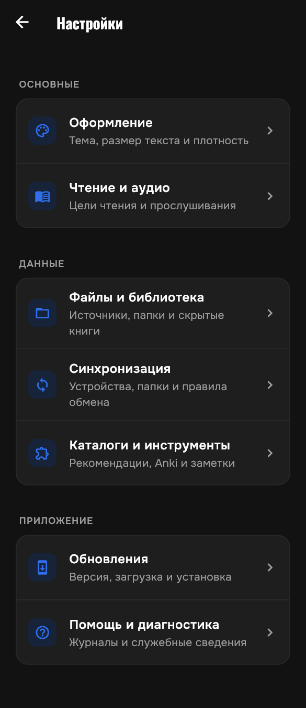
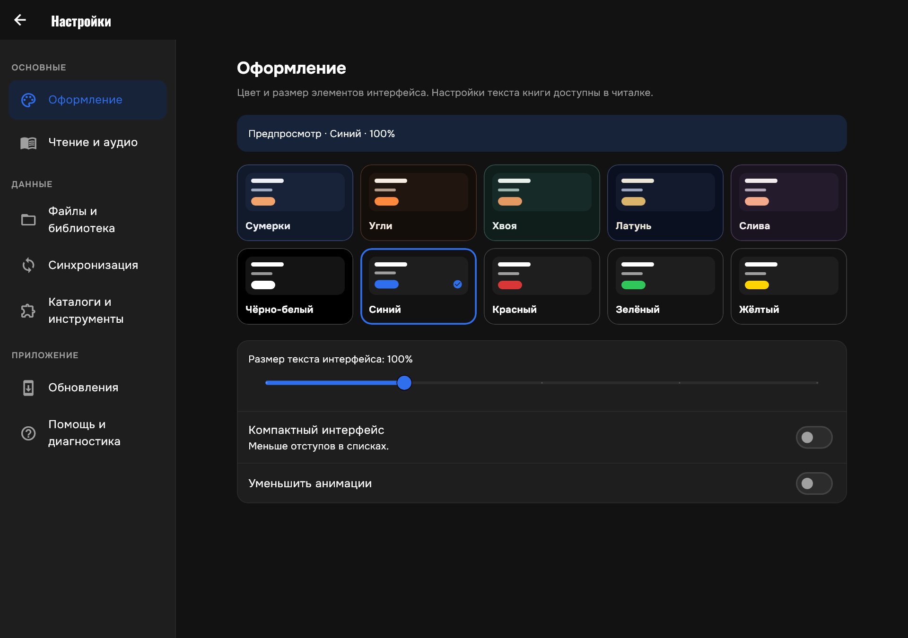
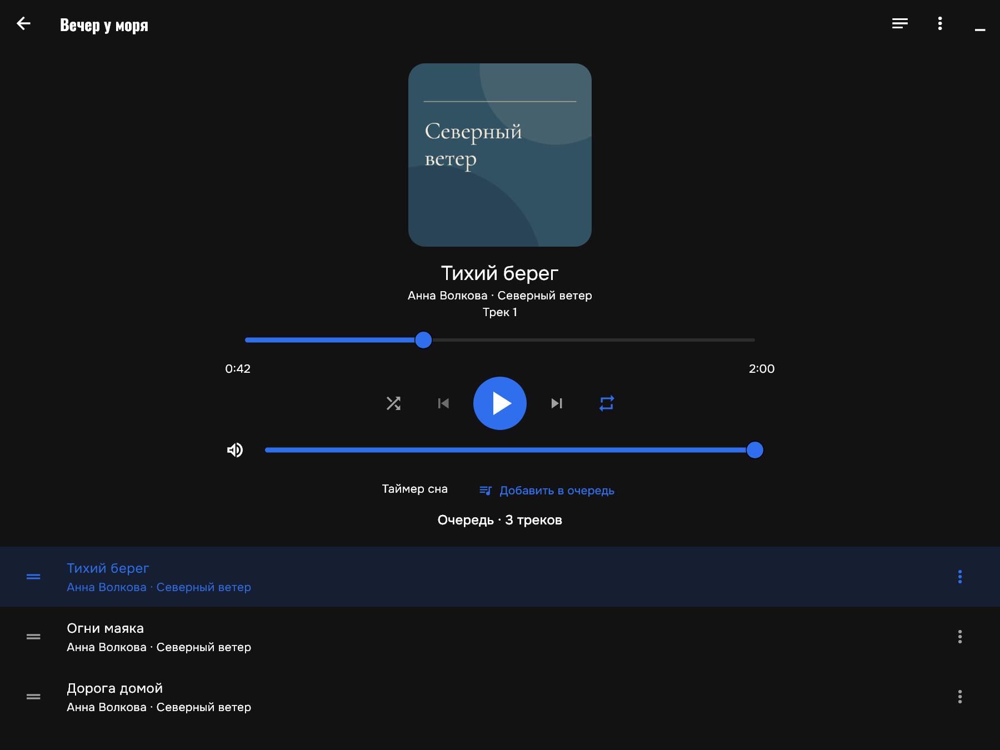
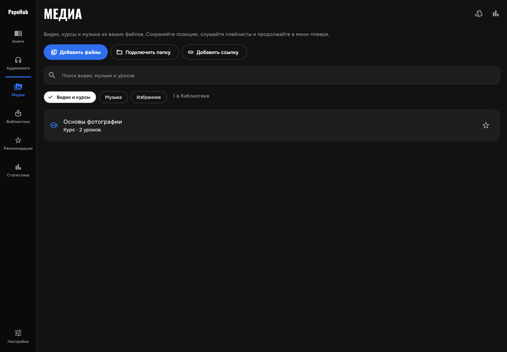
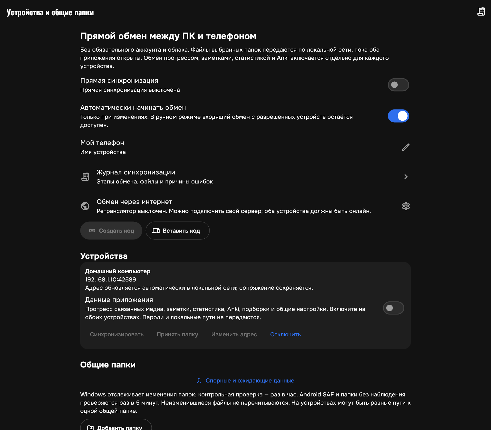
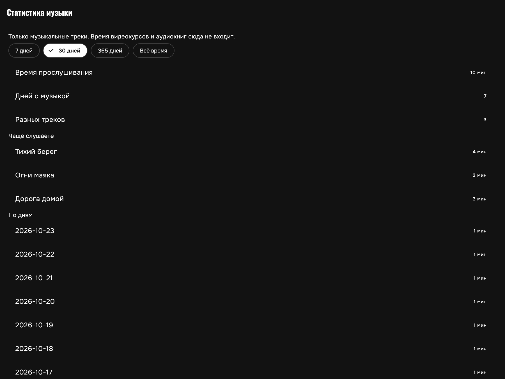
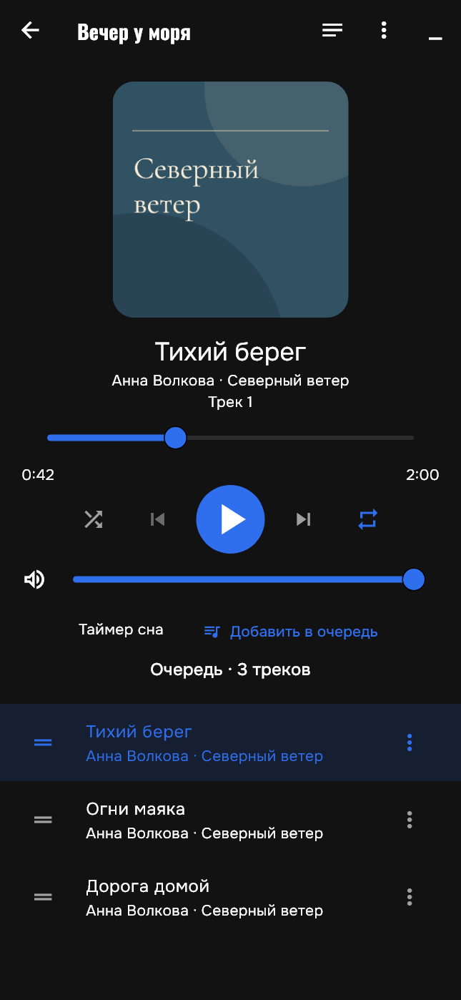

# PepeHub

**Читайте книги, слушайте аудиокниги и музыку, изучайте видеокурсы — в одном приложении.**

PepeHub — личная библиотека и медиатека для **Windows и Android**. Подключайте свои папки, продолжайте с сохранённого места, собирайте цитаты и подборки, следите за чтением и прослушиванием. Книги, аудиокниги, музыка и видеокурсы имеют свои сценарии управления и учёта.

Основные возможности работают **офлайн и без аккаунта**. По желанию подключаются синхронизация устройств, обмен с Obsidian и поиск книг во внешних каталогах.

[Скачать](#скачать-и-установить) · [Скриншоты](#скриншоты) · [Возможности](#возможности) · [Синхронизация](#синхронизация-устройств) · [Obsidian](#обмен-с-obsidian) · [Сборка](#для-разработчиков)

## Скачать и установить

Текущий выпуск — **0.26.0+74**. [Описание изменений](docs/RELEASE_0260.md) · [GitHub Releases](https://github.com/IshchenkoEvgeniy/PepeHub-Releases/releases).

| Платформа | Скачать | Установка |
|---|---|---|
| **Windows x64** | [ZIP 0.26.0](https://github.com/IshchenkoEvgeniy/PepeHub-Releases/releases/download/v0.26.0-74/PepeHub-windows-x64.zip) | Распакуйте **весь архив** и запустите `pepehub.exe`. DLL и каталог `data` должны оставаться рядом. |
| **Android ARM64, 7.0+** | [APK 0.26.0](https://github.com/IshchenkoEvgeniy/PepeHub-Releases/releases/download/v0.26.0-74/PepeHub-android-arm64.apk) | Установите APK поверх прежнего приложения. Сертификат подписи сохранён. |

Пакеты доступны публично без аккаунта. Размеры и **SHA-256** находятся в подписанном `update.json` выпуска. Приложение проверяет подпись и скачанные файлы автоматически.

В версиях с механизмом обновления откройте **Настройки → Обновления → Проверить обновления**. Для старой 0.19.0 новый пакет нужно установить вручную один раз. APK устанавливайте поверх прежнего приложения, данные не очищайте. [Как работают обновления](docs/APP_UPDATES.md).

### Что нового в 0.26.0

- Обновлён экспорт книг и аудиокниг в Obsidian: статусы коллекций, завершение, даты и согласованные единицы прогресса.
- Метки и подсказки авторов и жанров, поиск серий, календарь, оценка, обложка и подтверждаемый разбор имени аудиокниги.
- Сравнение данных при связывании карточки, выбор источников автообновления и сохранение значений шаблона.
- Единая транзакционная миграция схемы базы 4 с резервной копией перед обновлением; защита индексов от повреждённого JSON.

[Подробности выпуска](docs/RELEASE_0260.md). Для новых статусов и единиц обновите мост Obsidian и перезапустите плагин. После перехода на схему 4 откат на 0.25.x требует восстановления резервной копии.

### Что нового в 0.25.1

- Окна текстовой читалки и PDF наследуют выбранный стиль приложения: цвета, шрифты интерфейса, кнопки, поля и меню.
- Доступны 10 шрифтов для чтения с поддержкой украинского, русского и английского, работающих офлайн.
- Улучшена компоновка окна оформления на невысоких экранах; выбор шрифта сохраняется после перезапуска.

[Подробности выпуска](docs/RELEASE_0251.md).

### Что нового в 0.25.0

- Компактное меню выделения с палитрой по нажатию и отдельной панелью дополнительных действий.
- Новое оформление чтения с вкладками, предпросмотром и постоянными кнопками сохранения и отмены.
- В PDF добавлены масштаб, подгонка страницы и обрезка белых полей; отмена восстанавливает прежний вид.
- Исправлены старые сноски EPUB и точные переходы по ссылкам PDF с возвратом к прежнему месту.

[Подробности выпуска](docs/RELEASE_0250.md).

### Исправления в 0.24.4

- Исправлен чёрный экран книги при недоступных размерах дисплея Android.
- Сохранены стабильные страницы при переключении интерфейса; добавлено восстановление при некорректных размерах окна и повороте.

[Подробности выпуска](docs/RELEASE_0244.md).

### Исправления в 0.24.3

- На Android страницы сохраняют размер, границы и положение текста при скрытии системных панелей, даже когда меняется само окно приложения.
- Кнопки перелистывания остаются в видимой области. Проверены оба положения экрана и все четыре режима текстовой читалки.

[Подробности выпуска](docs/RELEASE_0243.md).

### Исправления в 0.24.2

- Страницы читалки сохраняют размеры при скрытии панелей; улучшены полноэкранный режим, нажатия, ссылки и сноски.
- Книги без указанного формата снова видны на полке; исправлено отображение их карточек.
- Боковое меню настроек на ПК переключает разделы без накопления истории.
- Восстановление и удаление книги доступны сразу, настройки действий разделены для текстовой и аудиополки.
- Уточнены действия источника книги, подтверждение копирования пути и недоступные настройки.

[Подробности выпуска](docs/RELEASE_0242.md).

### Что нового в 0.24.1

- **Anki во время просмотра:** видео продолжает играть, доступны пауза и перемотка. Можно сохранять карточки подряд с отдельным временем источника.
- **Читаемые активные элементы:** исправлен контраст фильтров и кнопок во всех десяти темах.
- **Настраиваемое меню книги:** действия собраны в разделы; ненужные функции можно скрывать и возвращать галочками через кнопку настройки.

[Подробности выпуска](docs/RELEASE_0241.md).

### Что нового в 0.24.0

- **Каталог настроек:** отдельные разделы на телефоне и меню слева на ПК. Синхронизация, обновления и локальные папки больше не смешаны в одном длинном экране.
- **Управляемый автообмен:** интервал от 15 минут до суток, по умолчанию час; ручной обмен работает сразу. Неизменившийся индекс не передаётся целиком.
- **Понятная библиотека:** карточки синхронизации без локального файла вынесены в «Без файла», доступны источник, путь и массовое скрытие с сохранением истории.
- **Обновления по шагам:** проверка → загрузка → установка; источник и служебные сведения открываются отдельно. Сертификат Android сохранён.

[Подробности выпуска](docs/RELEASE_0240.md) · [Синхронизация и источники книг](docs/SYNC_LIBRARY_BEHAVIOR.md).

### Исправления в 0.23.1

- Компенсация инверсии растровых изображений в тёмной теме PDF.
- Исправление исчезновения библиотеки из-за настройки режима PDF и устойчивость к повреждённым записям метаданных.

[Подробности выпуска](docs/RELEASE_0231.md).

### Что нового в 0.23.0

- Общая нижняя панель текста и PDF, скрытие свайпом вниз и возврат свайпом вверх. Лишняя шкала загруженных страниц убрана.
- Выделение нескольких абзацев, рабочее меню PDF с цветами, заметками и Anki, быстрые закладки с процентом и фрагментом текста.
- Поиск «е/ё» и фраз через переносы, догрузка по F3, точная подсветка при смене главы.
- Горячие клавиши, предпросмотр и сохранение оформления при закрытии, распознавание глав TXT с переносом прежних позиций.
- Обновление боковых панелей и сохранение длинных сессий частями без потери событий и удвоения статистики.

[Подробности и проверки](docs/RELEASE_0230.md).

### Что нового в 0.22.2

- Оптимизация прокрутки, сносок, заметок, отметок глав и переходов поиска в читалке.
- Фоновая индексация больших PDF с сохранением достигнутого результата; дневная статистика без повторного разбора всей истории.
- Исправления оглавления и внутренних ссылок EPUB, вложенных глав FB2 и совместимости оформления PDF.

[Подробности и проверки](docs/RELEASE_0222.md).

### Исправление в 0.22.1

На Android музыка и аудиокниги продолжают после обычного уведомления при возврате аудиофокуса. Ручная пауза, таймер сна и отключение наушников отменяют автоматическое продолжение; настройка «Продолжать после звонка» сохранена. [Причины и проверки](docs/AUDIO_NOTIFICATION_FOCUS.md).

### Что нового в 0.22.0

- Музыка отделена от видеокурсов: свой экран, метаданные, обложки и статистика.
- Повтор трека/плейлиста, «Играть следующим», перетаскивание и восстановление очереди после перезапуска.
- QR-сопряжение с камерой Android, мастер общей папки и сравнение конфликтов по полям.
- У спорного места чтения — название главы и фрагмент локальной книги.
- Пакетная загрузка данных библиотеки, индексированная выборка заметок и дневные итоги аудиостатистики.

[Полный состав и проверки выпуска](docs/RELEASE_0220.md).

### Первые пять минут

1. В **«Книгах»** импортируйте файл или подключите папку с текстовыми книгами. Импорт создаёт независимую копию; подключение сохраняет связь с исходником.
2. Откройте книгу и выберите удобное оформление. Позиция сохраняется автоматически.
3. Выделите фрагмент, добавьте комментарий, цвет или тег. Сохранённые фрагменты доступны в заметках.
4. В **«Аудиокнигах»** подключите папку, проверьте найденные книги и порядок частей. Аудио читается напрямую из этой папки.
5. В **«Статистике»** посмотрите чтение и прослушивание; в настройках задайте дневные цели.

## Скриншоты

### Каталог настроек 0.24.0

Настоящие экраны Flutter из изолированной тестовой библиотеки: телефон и ПК. Пользовательские данные в снимках не используются.

| Телефон | ПК |
|---|---|
|  |  |

Снято **23 октября 2026 года** с текущих виджетов версии **0.22.0**. Использованы вымышленные книги, авторы, обложки и события; личные данные не задействованы. Состояние плееров демонстрационное. Мобильные снимки показывают адаптивную компоновку, а не аппаратный тест Android. Нажмите на изображение, чтобы открыть его целиком.

<table>
<tr>
<td width="50%" align="center"><b>Читалка</b> </td>
<td width="50%" align="center"><b>Аудиокниги</b> </td>
</tr>
<tr>
<td width="50%" align="center"><b>Музыкальный плеер</b> </td>
<td width="50%" align="center"><b>Видео и курсы</b> </td>
</tr>
<tr>
<td width="50%" align="center"><b>Цитаты и заметки</b> </td>
<td width="50%" align="center"><b>Чтение и прослушивание</b> </td>
</tr>
<tr>
<td width="50%" align="center"><b>Подборки книг</b> </td>
<td width="50%" align="center"><b>Библиотека Obsidian</b> </td>
</tr>
<tr>
<td width="50%" align="center"><b>Устройства и общие папки</b> </td>
<td width="50%" align="center"><b>Статистика музыки</b> </td>
</tr>
<tr><td colspan="2" align="center"><b>Оформление и настройки</b> </td></tr>
<tr>
<td width="50%" align="center"><b>Книги на телефоне</b> </td>
<td width="50%" align="center"><b>Музыка на телефоне</b> </td>
</tr>
</table>

## Возможности

Шесть разделов: **Книги · Аудиокниги · Медиа · Библиотека · Рекомендации · Статистика**. На широком экране используется боковая навигация, на узком — мобильная компоновка.

### Библиотека электронных книг

- Импорт файлов или подключение папки без постоянного копирования всей библиотеки. Android использует системный выбор файлов и папок — SAF.
- Извлечение названия, авторов, обложки, серии и номера тома там, где их содержит формат. Обновление сведений из файла и редактирование карточки.
- Поиск и совместные фильтры по статусу, формату, папке, избранному и коллекции. Сортировка по названию, автору, серии, прогрессу и недавней активности.
- Избранное и свои коллекции. Книга может входить в несколько коллекций; удаление коллекции сохраняет книги и историю.
- Карточка книги с позицией, заметками, статистикой и планом чтения.
- Повторный импорт определяется по содержимому. Отключение папки сохраняет заметки и прогресс; независимая импортированная копия остаётся доступной.

### Читалка

- Постраничное чтение, прокрутка, бесшовный и компактный режимы; размер шрифта, интервал, поля и высота страницы.
- Светлая, тёмная, сепия и системная палитры текста; Lora для книжного шрифта и Onest для варианта без засечек.
- Оглавление, поиск по книге, сохранение позиции, переход к заметке и возврат после переходов. Клавиатурная навигация на ПК.
- Полный экран и настраиваемые действия левой, центральной и правой зон нажатия.
- Локальные сноски EPUB/FB2 поверх текста; иллюстрации в панели главы с увеличением.
- Длинная цитата через несколько страниц одной главы с отдельным выбором начала и конца.
- Автоматический учёт активного времени. Фон, открытые панели и бездействие приостанавливают счётчик.

Также доступны: быстрое восстановление позиции в больших книгах, поиск по текущей главе с продолжением выдачи и переходами между совпадениями, системная палитра независимо от темы библиотеки и настройка ширины колонки. Также доступны быстрые цвета выделения с запоминанием выбора, скрытие подсветок, именованные закладки с переименованием и отменой удаления, поиск главы по названию или номеру. [Описание и управление](docs/READER_NAVIGATION_AND_SEARCH.md).

### PDF

- Исходная вёрстка, масштабирование, оглавление и поиск по текстовому слою.
- Цветные цитаты, комментарии и заметки к страницам; переходы по внутренним ссылкам.
- Темы, полный экран, сохранение позиции и альтернативный текстовый режим с настройкой шрифта.
- Общая статистика и планы чтения при наличии извлекаемого текста.

[Возможности PDF и ограничения](docs/PDF_READER_PARITY.md).

### Аудиобиблиотека

- Папки подключаются **без копирования аудиофайлов**. Импорт отдельных файлов с копированием — отдельная команда.
- Предпросмотр найденных книг, естественная сортировка частей по номерам, объединение дисков и пронумерованных частей. Доступны объединение и разделение карточек.
- Несколько треков образуют одну книгу с общей позицией. M4B поддерживает встроенные главы, если они есть в файле.
- Избранное, коллекции, статусы, поиск и фильтры; сортировка по автору, прогрессу, активности и длительности.
- Обложки из файла или папки и выбор своей обложки; сохранение порядка частей.
- Обновление и отключение корней, переименование отображаемого названия. Папку книги можно переименовать или переместить внутри поддерживаемого подключённого корня по явной команде пользователя.

[Устройство каталога](docs/AUDIOBOOK_CATALOG.md) · [Коллекции и сортировка](docs/AUDIOBOOK_ORGANIZATION.md).

### Аудиоплеер

- Общая шкала книги и шкала текущего трека; переходы по трекам и встроенным главам.
- Скорость воспроизведения, перемотки на 10 секунд и минуту, история перемоток с возвратом к исходной позиции.
- Продолжение с сохранённого места; мини-плеер для управления звучащей книгой из других разделов.
- Таймер сна на время, до конца главы или трека; плавное затухание, возврат на 10 секунд после сна и продление таймера.
- Закладки и заметки к позиции: мысль, цитата или персонаж. Редактирование, удаление и восстановление удалённых закладок.
- Фоновое воспроизведение, системные медиакнопки Android, обработка аудиофокуса и отключения наушников. Декодирование зависит от формата и платформенного движка.

[Плеер](docs/AUDIOBOOK_PLAYER_091.md) · [Заметки и мини-плеер](docs/AUDIOBOOK_NOTES_MINIPLAYER_093.md) · [Android-медиакнопки](docs/ANDROID_MEDIA_CONTROLS.md).

### Музыка

В **Медиа → Музыка** есть отдельный плеер и музыкальная статистика. Аудиокниги остаются в своём разделе.

- Музыкальные файлы, папки с треками и прямые HTTP(S)-ссылки; поиск по названию, исполнителю и альбому после чтения тегов.
- Название, исполнитель, альбом и номер трека. Доступные теги читаются при открытии; сведения можно изменить без перезаписи аудиофайла.
- Встроенные обложки ID3, MP4/M4A и FLAC; на Android SAF — также системное извлечение. При отсутствии встроенной картинки проверяется соседняя обложка.
- Перемешивание, повтор одного трека и всего плейлиста, предыдущий/следующий трек.
- **Играть следующим**, перетаскивание и удаление из очереди, возврат треков через **Добавить в очередь**. Порядок файлов библиотеки не меняется.
- Восстановление очереди, текущего трека, перемешивания и повтора после перезапуска. Очередь хранится локально на каждом устройстве.
- Перемотка, громкость, таймер сна, мини-плеер, фоновое воспроизведение и системные медиакнопки. Таймер до конца трека имеет приоритет над повтором.
- Отдельные итоги за 7/30/365 дней или всё время: прослушанное время, активные дни и треки. Время музыки не входит в отчёты видеокурсов.

[Импорт, управление и ограничения музыки](docs/MEDIA_MUSIC.md).

### Видео, курсы и обучение

В **Медиа → Видео и курсы** доступны отдельные файлы, папки с уроками и прямые ссылки на медиа.

- Предварительная проверка порядка уроков, модули, изменение названий, обновление и переподключение папки с сохранением истории.
- Позиция и скорость воспроизведения, полноэкранный режим, мини-плеер и аудиорежим.
- Дорожки звука и субтитров, две строки субтитров, поиск по расшифровке и переход к реплике; возможности зависят от источника.
- A–B-повтор фрагмента с числом повторений и паузами, повтор реплики и история перемоток.
- Заметки с временной привязкой; словарь и карточки Anki из контекста урока. Карточки можно создавать и из текста книги или аудиопозиции.
- Статистика видеокурсов: фактическое время, просмотренные интервалы, повторное изучение и история сессий. Музыкальные треки учитываются отдельно.

[Устройство видеокурсов](docs/VIDEO_SPECIFICATION.md) · [Словарь и экспорт Anki](docs/ANKI_AND_LIBRARY_DEFAULTS.md).

### Цитаты и заметки

- Цветные выделения, исходная цитата и комментарий; теги и персонажи.
- Поиск и комбинированные фильтры по книге, цвету, тегам и персонажам; списки заметок книги и всей библиотеки.
- Редактирование комментария и оформления, удаление с отменой; переход к исходному фрагменту при доступной привязке.
- Экспорт заметок текстовых книг в **Markdown или JSON**.
- Отдельный просмотр полученных заметок Obsidian, в том числе без связанного локального файла.

[Как работать с заметками](docs/READING_NOTES_TOOLS_0101.md).

### Статистика, история и планы

- Общая статистика чтения и прослушивания за год, календарь и основные показатели. Подробные экраны по виду активности и отдельной книге.
- Активное время, дневные цели, серии дней; выбор периода, поиск и фильтрация истории.
- Для текста — новое продвижение, повторное чтение и оценка скорости. Для аудио — звучавшее время, прослушанный объём и повторные интервалы с учётом скорости.
- Просмотр, исправление, добавление и удаление автоматических интервалов и ручных сессий; пересчёт итогов.
- План книги: минуты в день, целевой объём, дата завершения, оценка оставшегося времени и необходимого ежедневного усилия.
- Экспорт статистики в **CSV**, аудиостатистики — также в **JSON**. При недостатке данных скорость и сроки не выдумываются.

Статистика отражает действия в приложении: процент позиции не равен прочитанному объёму, оценка активности не измеряет внимание. [Планы](docs/READING_PLANS_0101.md) · [Учёт чтения](docs/READING_ACTIVITY_0101.md) · [Аудиостатистика](docs/AUDIOBOOK_PROGRESS_STATISTICS_080.md).

### Рекомендации и личные подборки

- Собственные категории и топы; у книги может быть разное место в разных категориях.
- Быстрый выбор подборок из меню книги, команды «Поднять / Опустить» и перетаскивание внутри выбранного топа; сортировки по названию, автору и дате добавления.
- Ручные карточки, личные заметки, поиск по сохранённым названиям, авторам, темам и комментариям.
- Поиск по названию, автору, ISBN или поддерживаемой ссылке в **Inventaire, Open Library и Author.Today**.
- Постепенная выдача результатов, состояния источников, отдельный повтор при ошибке и отметка «Уже в подборках».
- Аннотации, авторы, серии, языки, издания, темы и обложки — в пределах данных выбранного источника.
- Просмотр полной карточки на телефоне с отдельной кнопкой редактирования; понятные пустые состояния и сброс поискового фильтра.
- Дополнение пустых полей с сохранением ручных исправлений; настройка источников и копирование подборок в JSON.

Подборки хранятся локально; сеть нужна для поиска, дополнения сведений и внешних обложек. Это инструмент собственного выбора, а не обещание автоматического рекомендательного алгоритма. [Инструкция](docs/BOOK_RECOMMENDATIONS.md).

### Оформление

- Десять цветовых стилей основного тёмного интерфейса, масштаб текста, компактность и уменьшение анимаций.
- Независимые настройки читалки, дневные цели чтения и прослушивания.
- Выбор источников рекомендаций и настройка обмена с Obsidian: период обновления, журнал, обложки и заметки.
- Onest, Oswald, Cormorant Garamond и Lora включены в приложение и доступны без сети. [Шрифты и лицензии](apps/pepehub/assets/fonts/README.md).

## Поддерживаемые форматы

| Тип | Форматы | Особенности |
|---|---|---|
| Книги | **EPUB, FB2, FB2.ZIP** | Главы, метаданные и обложки; поддерживаемые локальные сноски и иллюстрации. |
| Текст и документы | **TXT, Markdown, HTML, DOCX, RTF** | Чтение извлечённого текста; полная исходная вёрстка поддерживается не для всех форматов. |
| PDF | **PDF** | Исходная вёрстка и текстовый режим; поиск и цитирование требуют текстового слоя. |
| Аудиокниги | **MP3, M4B, M4A, AAC, OGG, Opus, FLAC, WAV** | Отдельные файлы и многотрековые книги; встроенные главы M4B при наличии. |

Пределы: 64 МиБ для книги, 256 МиБ для PDF, 8 ГиБ на файл аудиоимпорта. Для разобранного текста и архивов действуют дополнительные ограничения. Поддержка расширения не гарантирует чтение любого повреждённого или нестандартного файла. [Форматы, кодировки и точные ограничения](docs/FORMATS.md).

## Обмен с Obsidian

Локальные книги связываются с Markdown-карточками через мост **Habit Timer + Cloudflare Companion**. Подключение необязательно для чтения и прослушивания.

| Данные | Возможности |
|---|---|
| Карточки | Получение метаданных, создание карточки, явная связь с существующей, редактирование свойств и алиасов. |
| Журнал | Чтение и прослушивание в обе стороны; UUID, версии и удаления. |
| Заметки | Цитаты, комментарии, теги, персонажи, цвет и текстовые/аудиопривязки. |
| Обложки | Защищённый обмен и локальный кеш. |
| Конфликты | Сохранение обеих версий до явного выбора. |

Файлы **книг и аудио не передаются**. Полная синхронизация vault, аудиопозиции между устройствами и новые подборки рекомендаций в этот обмен не входят.

Нужны обновлённый Habit Timer, настроенный Companion, миграции и URL/токен в приложении. Для применения правок Markdown Obsidian должен быть запущен; до этого команды ожидают подтверждения. Потеря сети сохраняет очередь, повтор запроса не создаёт вторую запись.

**Установка приложения сама по себе не обновляет Obsidian-плагин.** [Установка моста и настройка обмена](docs/OBSIDIAN_LIBRARY.md).

## Хранение данных и работа офлайн

| Данные | Где и как хранятся |
|---|---|
| Карточки, позиции, заметки, коллекции, планы, статистика | Локальная SQLite-база приложения. |
| Импортированный файл | Независимая копия в данных приложения; исходник сохраняется. |
| Подключённая папка | Ссылки на оригиналы. Перемещение папки или отзыв SAF-доступа может потребовать повторного подключения. |
| Открытая текстовая книга из Android SAF | При необходимости создаётся проверяемый локальный кеш для читалки. |
| Подключённые журналы и аудиоснимки | Служебные файлы `.pepehub` в выбранной папке с предусмотренными данными для восстановления. |

Чтение, прослушивание доступных файлов, локальные заметки и статистика работают офлайн. Сеть используется для включённого обмена с Obsidian и обращения к внешним книжным источникам.

Журналы и аудиоснимки **не являются полной резервной копией базы**: все настройки, коллекции, планы и заметки не гарантированно восстанавливаются только из `.pepehub`. Не очищайте данные приложения для обычного обновления. Новые аудиожурналы версии 2 требуют актуального приложения. [Аудиожурналы](docs/AUDIOBOOK_COMPACT_LOGS_092.md) · [Резервные снимки](docs/AUDIOBOOK_COVERS_BACKUPS.md).

## Каталог настроек

Семь групп: **Оформление**, **Чтение и аудио**, **Файлы и библиотека**, **Синхронизация**, **Каталоги и инструменты**, **Обновления**, **Помощь и диагностика**. На телефоне — отдельные страницы, на ПК — меню слева. Переключатели сохраняются сразу; кнопка назад возвращает к предыдущему разделу. Мини-плеер остаётся доступен.

Папки полки и общие папки для обмена настраиваются отдельно. У устройств и Obsidian разные расписания и кнопки обмена. Технические адреса, источник пакета обновления и подробные журналы доступны по запросу.

## Синхронизация устройств

**Настройки → Синхронизация** — прямой обмен между Windows и Android без обязательного аккаунта и облака.

1. Создайте код на одном устройстве. На Android отсканируйте QR или вставьте код вручную. Приглашение одноразовое и действует пять минут.
2. Подключите общую папку через мастер: выберите путь, назначение библиотеки, режим загрузки и разрешённые устройства. Предпросмотр показывает локальные файлы и размер без записи служебных файлов.
3. На втором устройстве примите папку и выберите свой локальный путь. Для обмена позициями и заметками включите **Данные приложения** на обоих устройствах.

- Обмен файлами выбранных папок и связанными данными: прогресс, заметки, статистика, Anki, подборки и часть общих настроек.
- Разные локальные пути на устройствах, выборочная загрузка, докачка и поиск изменившегося LAN-адреса.
- Защищённое сопряжение и шифрование, повторные попытки, подтверждение входящих удалений и сохранение конфликтующих версий.
- Сравнение конфликтов по полям. Для позиции чтения — глава, процент и фрагмент локальной текстовой книги; для PDF — страница.
- Журнал этапов, файлов и ошибок, необязательная история прежних версий файлов общих папок.
- В локальной сети оба приложения должны быть доступны; для обмена через интернет нужен свой WSS-ретранслятор. Фоновые режимы Android зависят от разрешений и ограничений системы.

Предпросмотр мастера показывает локальный состав и правила, а не точную разницу с удалённым устройством. Полный образ базы и произвольная синхронизация всех настроек не передаются. Ключи, токены и локальные пути не входят в прикладной обмен. Для новых музыкальных полей обновите оба устройства.

[Общие папки](docs/DEVICE_SYNC_FOLDER_WORKFLOWS.md) · [Данные и конфликты](docs/DEVICE_SYNC_APPLICATION_DATA.md) · [Интернет-ретранслятор](docs/PEER_RELAY.md) · [Диагностика](docs/DEVICE_SYNC_DIAGNOSTICS.md).

## Обновления приложения

**Настройки → Обновления → Проверить обновления**. Windows скачивает проверенный пакет и обновляет файлы с перезапуском; Android открывает системную установку APK поверх приложения. Доступны прогресс загрузки, отмена и докачка.

Манифест проверяется подписью Ed25519, пакеты — по размеру и SHA-256; Android дополнительно сверяет сертификат, идентификатор и номер версии. Автоматическая проверка выполняется не чаще раза в 12 часов, ручная кнопка проверяет сразу. Установка начинается по действию пользователя.

Для старых сборок без механизма обновления новый пакет нужно установить вручную один раз. **Не удаляйте приложение и не очищайте его данные для обычного обновления.** [Установка, защита и восстановление](docs/APP_UPDATES.md).

## Ограничения

- Нет OCR: для PDF-сканов нужен внешний текстовый слой. DRM, MOBI/AZW, DjVu и старый DOC не поддерживаются.
- EPUB не воспроизводит всю CSS-вёрстку; DOCX/RTF открываются как текст, без точного исходного оформления. Длинная цитата ограничена одной главой.
- URL должен вести к доступному медиаисточнику; ссылка на страницу видеосервиса сама по себе не гарантирует воспроизведение.
- Кодеки, аудиофокус, камера QR и фоновые ограничения требуют проверки на конкретном устройстве. Рендер мобильного интерфейса не заменяет аппаратный тест.
- Синхронизация устройств и мост Obsidian — разные механизмы; установка PepeHub не обновляет Obsidian-плагин и не настраивает сервер.
- Служебные журналы не заменяют полную резервную копию. Объёмы предельных библиотек и выигрыш от оптимизаций отдельно не измерялись.

## Для разработчиков

### Стек и структура

**Flutter / Dart** — приложение; **SQLite / Drift** — локальные данные; **TypeScript / Node.js** — протокол, проверки и локальный сервер; **Cloudflare Workers / D1** — прототип API и серверная часть моста.

~~~text
apps/pepehub/           Flutter-приложение, Android и Windows
  lib/reader/          Читалка, PDF, заметки, учёт и планы
  lib/audio/           Каталог, главы, журналы и аудиостатистика
  lib/library/         Обмен библиотекой, журналами, обложками и заметками
  lib/recommendations/ Личные подборки и книжные источники
  lib/media/           Файлы, SAF, аудиоконтроллер и восстановление
  lib/music/           Музыкальный экран, метаданные и статистика
  lib/video/           Курсы, медиасеанс, субтитры и обучение
  lib/sync/peer/       Прямой обмен, общие папки и прикладные данные
  lib/ui/              Экраны, оформление и адаптивная навигация
contracts/             Типы и проверка прототипного протокола
services/sync-worker/   Прототип Worker API и миграции D1
integrations/obsidian/  Исходники моста Habit Timer
scripts/               Сборка, установка моста и локальные серверы
tests/                 Серверные и интеграционные проверки TypeScript
docs/                  Инструкции, скриншоты и история выпусков
~~~

Выпуск 0.22.0 собран с **Flutter 3.47.3 / Dart 3.13.3**. Для Windows нужен C++ toolchain Visual Studio, для Android — Android SDK/NDK и JDK. Серверные тесты используют **Node.js 24+**. [Зависимости приложения](apps/pepehub/pubspec.yaml) · [Зависимости серверных проверок](package.json).

### Запуск и сборка

Из корня репозитория:

~~~powershell
Push-Location apps/pepehub
flutter pub get
flutter run -d windows

# Windows release: build/windows/x64/runner/Release
flutter build windows --release

# Android ARM64 release
flutter build apk --release --target-platform=android-arm64 --split-per-abi
Pop-Location
~~~

Для подготовленной среды `.tools` есть `./scripts/build-android.ps1`: он проверяет подпись, версию, ABI, выравнивание и аудиоресурсы, создаёт пакет в `dist`. [Android-среда и подпись](docs/ANDROID.md). Для обычной работы приложения локальный API не нужен.

Локальные кнопки `.local/claude-check.cmd` и `.local/claude-android.cmd` используют общий `scripts/run-local-build.ps1`: подготовка зависимостей, анализ, тесты, сборка и открытие результата после успеха. [Порядок запуска и логи](docs/LOCAL_BUILDS.md).

### Проверки

~~~powershell
npm ci
npm test
npm run typecheck

Push-Location apps/pepehub
flutter analyze
flutter test
Pop-Location
~~~

Для **0.22.0** прошли **564 Flutter-теста** (13 пропущены); Dart-анализ — без замечаний. Для пакета изменений проверены **127 Android JVM/Robolectric-тестов**. Обе release-сборки собраны, подпись и пакеты публичного канала проверены, включая обнаружение обновления с 0.21.9. Эти результаты не заменяют аппаратную проверку телефона. [Результаты выпуска](docs/RELEASE_0220.md).

Как обновить скриншоты README

Основные книжные экраны можно переснять включаемым вручную рендерером реальных виджетов. Данные синтетические, база в памяти, внешние сервисы не используются. Обычный прогон пропускает этот сценарий.

~~~powershell
Push-Location apps/pepehub
$env:PEPEHUB_README_SCREENSHOTS = '1'
flutter test test/readme_screenshots_test.dart
Remove-Item Env:PEPEHUB_README_SCREENSHOTS
Pop-Location
~~~

PNG сохраняются в `docs/screenshots/`. Перед публикацией проверьте каждое изображение и обновите подписи при изменении интерфейса.

## Документация

| Тема | Материалы |
|---|---|
| Начало работы | [Быстрый старт](docs/GETTING_STARTED.md), [Android](docs/ANDROID.md) |
| Чтение | [Читалка](docs/READER_010.md), [форматы](docs/FORMATS.md), [PDF](docs/PDF_READER_PARITY.md) |
| Заметки и планы | [Инструменты заметок](docs/READING_NOTES_TOOLS_0101.md), [планы](docs/READING_PLANS_0101.md), [Anki и папки по умолчанию](docs/ANKI_AND_LIBRARY_DEFAULTS.md) |
| Аудиокниги | [Каталог](docs/AUDIOBOOK_CATALOG.md), [папки без копирования](docs/AUDIOBOOK_LINKED_FOLDERS.md), [многотрековый режим](docs/AUDIOBOOK_MULTITRACK.md) |
| Подборки и обмен | [Рекомендации](docs/BOOK_RECOMMENDATIONS.md), [Obsidian](docs/OBSIDIAN_LIBRARY.md) |
| Музыка и видеокурсы | [Музыка](docs/MEDIA_MUSIC.md), [видеокурсы](docs/VIDEO_SPECIFICATION.md), [проверки 0.22.0](docs/MUSIC_SYNC_PERFORMANCE_VALIDATION.md) |
| Устройства и общие папки | [Прямая синхронизация](docs/DEVICE_SYNC_SPECIFICATION.md), [этапы реализации](docs/DEVICE_SYNC_IMPLEMENTATION_PLAN.md) |
| Обновления приложения | [Windows/Android, установка и публикация выпусков](docs/APP_UPDATES.md) |
| Разработка и выпуски | [Архитектурный план](ARCHITECTURE.md), [проверки](docs/VALIDATION.md), [выпуск 0.22.0](docs/RELEASE_0220.md) |

Часть документов описывает исторические этапы; актуальный состав выпуска указан в release notes. Не добавляйте в Git личные книги, базу приложения, токены, ключи подписи и содержимое `.local`/`.tools`.
