# PepeHub

**Читайте книги, слушайте аудиокниги и музыку, изучайте видеокурсы — в одном приложении.**

PepeHub — личная библиотека и медиатека для **Windows и Android**. Подключайте свои папки, продолжайте с сохранённого места, собирайте цитаты и подборки, следите за чтением и прослушиванием. Книги, аудиокниги, музыка и видеокурсы имеют свои сценарии управления и учёта.

Основные возможности работают **офлайн и без аккаунта**. Библиотека переносится между телефоном и ПК через Syncthing; по желанию подключается поиск книг во внешних каталогах.

[Скачать](#скачать-и-установить) · [Скриншоты](#скриншоты) · [Возможности](#возможности) · [Синхронизация](#синхронизация-через-syncthing) · [Сборка](#для-разработчиков)

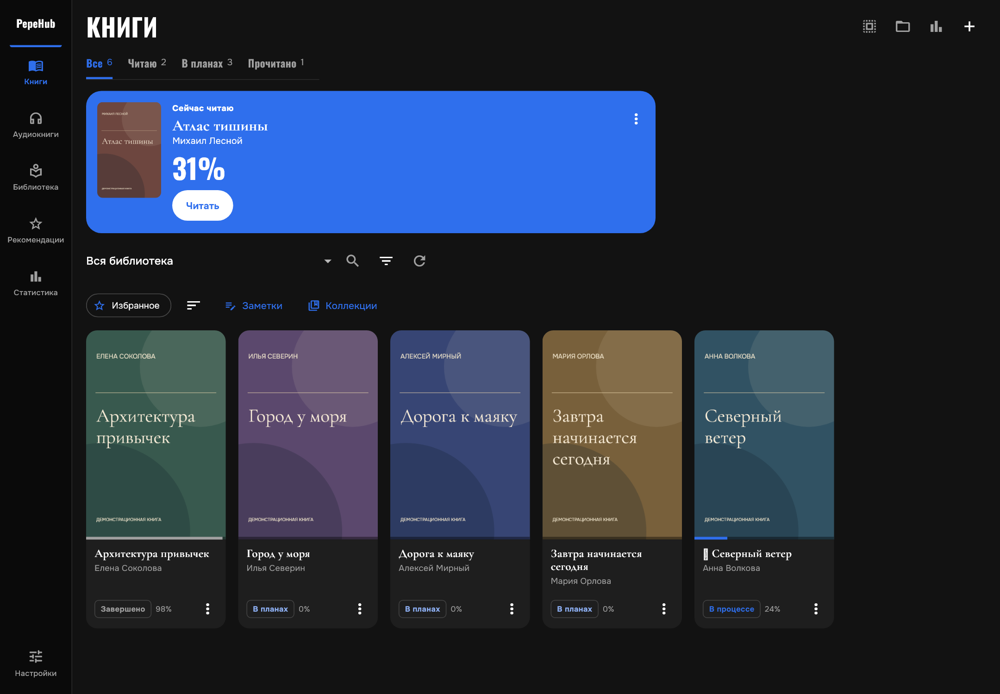

## Скачать и установить

Ссылки ниже всегда ведут на последний выпуск для Windows и Android. [Заметки выпусков](docs/releases/) · [GitHub Releases](https://github.com/IshchenkoEvgeniy/PepeHub-Releases/releases).

| Платформа | Скачать | Установка |
|---|---|---|
| **Windows x64** | [ZIP](https://github.com/IshchenkoEvgeniy/PepeHub-Releases/releases/latest/download/PepeHub-windows-x64.zip) | Распакуйте **весь архив** и запустите `pepehub.exe`. DLL и каталог `data` должны оставаться рядом. |
| **Android ARM64, 7.0+** | [APK](https://github.com/IshchenkoEvgeniy/PepeHub-Releases/releases/latest/download/PepeHub-android-arm64.apk) | Установите APK поверх прежнего приложения. Сертификат подписи сохранён. |

Пакеты доступны публично без аккаунта. Размеры и **SHA-256** находятся в подписанном `update.json` выпуска. Приложение проверяет подпись и скачанные файлы автоматически.

В версиях с механизмом обновления откройте **Настройки → Обновления → Проверить обновления**. Для старой 0.19.0 новый пакет нужно установить вручную один раз. APK устанавливайте поверх прежнего приложения, данные не очищайте. [Как работают обновления](docs/APP_UPDATES.md).

### Что нового в 0.31

- Встроенная синхронизация устройств, серверы и обмен с Obsidian удалены. Библиотека переносится между телефоном и ПК как обычная папка через Syncthing — [как настроить](#синхронизация-через-syncthing).
- Перед обновлением базы приложение сохраняет её копию. Карточки книг, которые пришли только через прежнюю синхронизацию (без файла на устройстве и без карточки библиотеки), удаляются; история чтения остаётся.
- Из выпусков 0.30: книжный календарь и итоги года, серии в библиотеке, отдельная папка личной библиотеки, перенос статистики.

[Заметки 0.31.0](docs/releases/RELEASE_0310.md) · [все выпуски](docs/releases/).

### Первые пять минут

1. В **«Книгах»** импортируйте файл или подключите папку с текстовыми книгами. Импорт создаёт независимую копию; подключение сохраняет связь с исходником.
2. Откройте книгу и выберите удобное оформление. Позиция сохраняется автоматически.
3. Выделите фрагмент, добавьте комментарий, цвет или тег. Сохранённые фрагменты доступны в заметках.
4. В **«Аудиокнигах»** подключите папку, проверьте найденные книги и порядок частей. Аудио читается напрямую из этой папки.
5. В **«Статистике»** посмотрите чтение и прослушивание; в настройках задайте дневные цели.

## Скриншоты

### Каталог настроек 0.24.0

Настоящие экраны Flutter из изолированной тестовой библиотеки: телефон и ПК. Пользовательские данные в снимках не используются.

| Телефон | ПК |
|---|---|
| 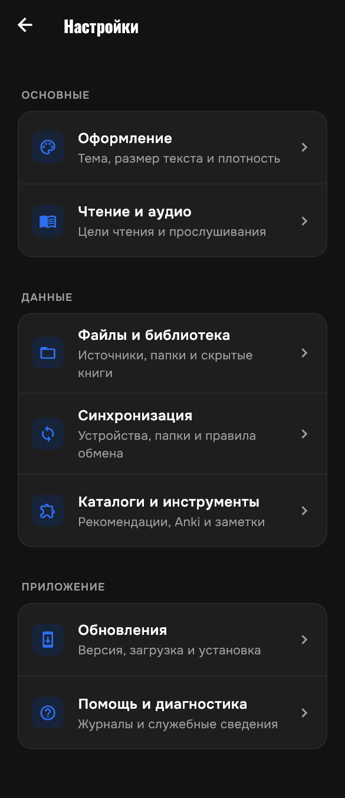 | 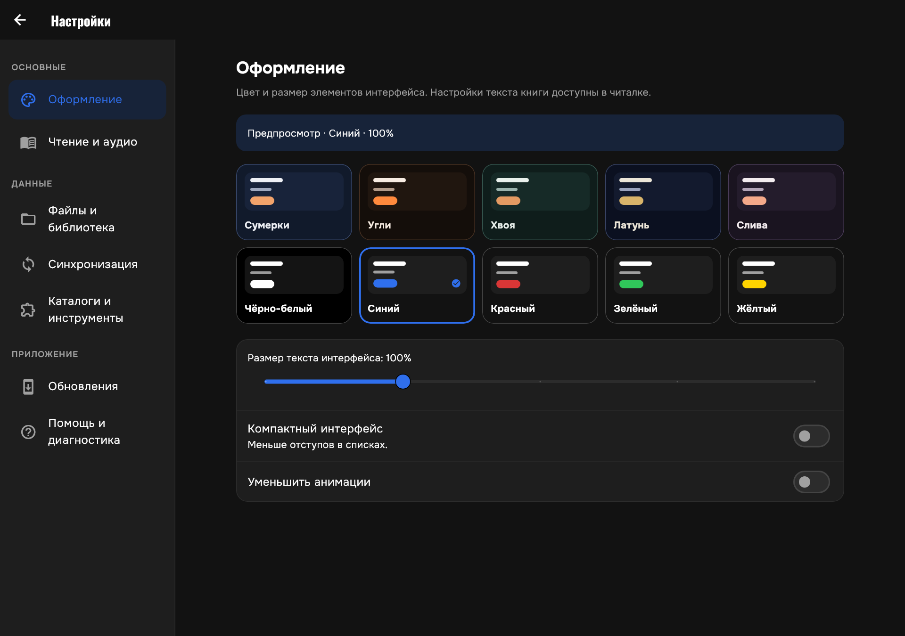 |

Снято **23 октября 2026 года** с текущих виджетов версии **0.22.0**. Использованы вымышленные книги, авторы, обложки и события; личные данные не задействованы. Состояние плееров демонстрационное. Мобильные снимки показывают адаптивную компоновку, а не аппаратный тест Android. Нажмите на изображение, чтобы открыть его целиком.

<table>
<tr>
<td width="50%" align="center"><b>Читалка</b> <a href="docs/screenshots/reader.png">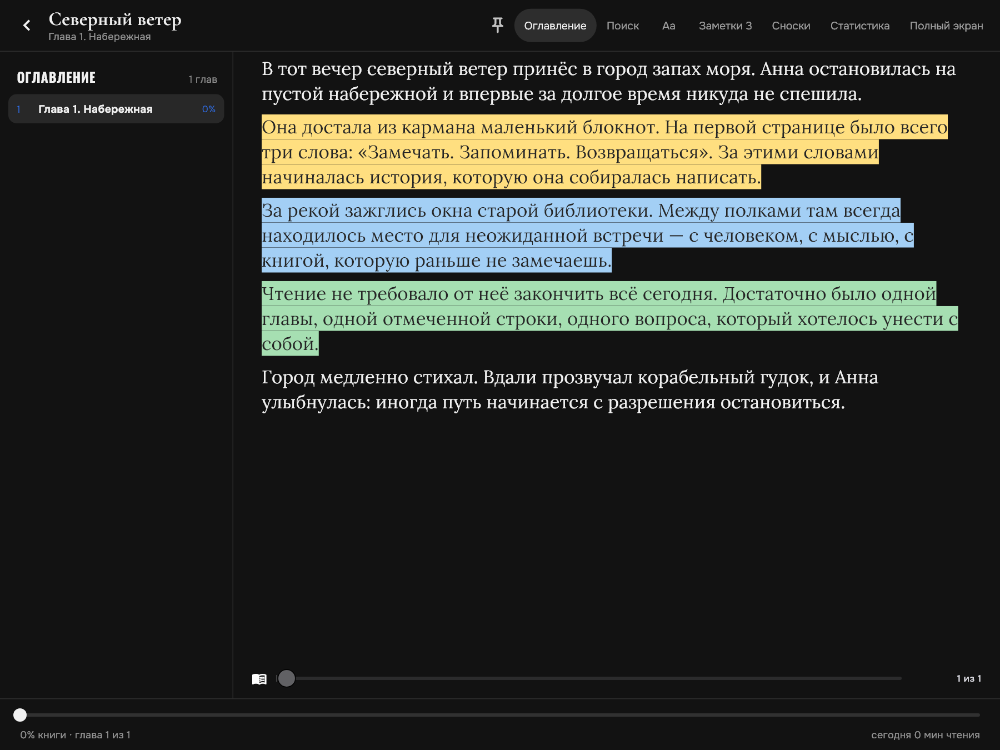</a></td>
<td width="50%" align="center"><b>Аудиокниги</b> <a href="docs/screenshots/player.png">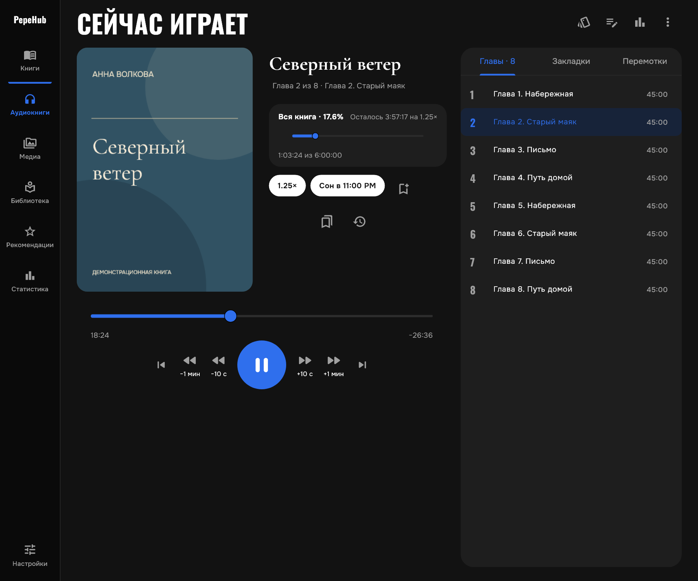</a></td>
</tr>
<tr>
<td width="50%" align="center"><b>Музыкальный плеер</b> <a href="docs/screenshots/music.png">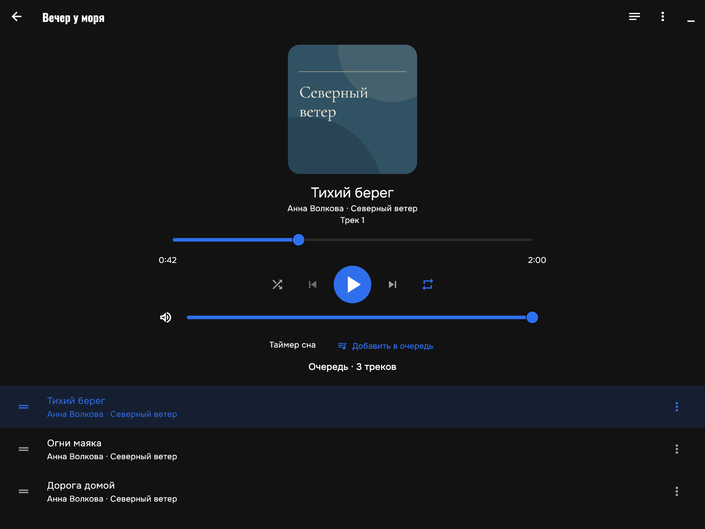</a></td>
<td width="50%" align="center"><b>Видео и курсы</b> <a href="docs/screenshots/media.png">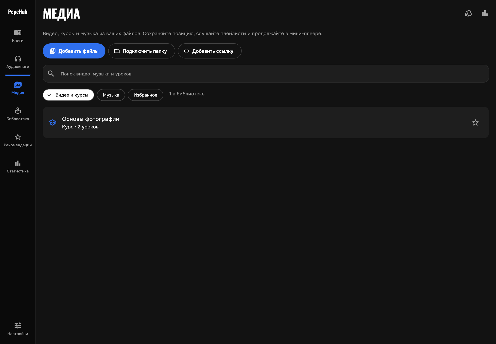</a></td>
</tr>
<tr>
<td width="50%" align="center"><b>Цитаты и заметки</b> <a href="docs/screenshots/notes.png">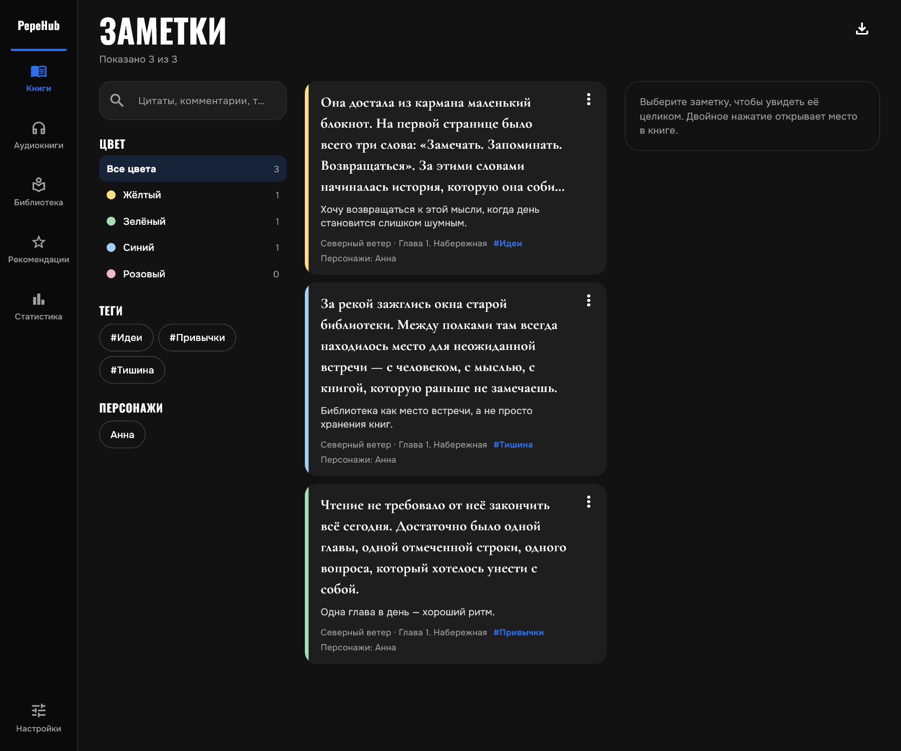</a></td>
<td width="50%" align="center"><b>Чтение и прослушивание</b> <a href="docs/screenshots/statistics.png">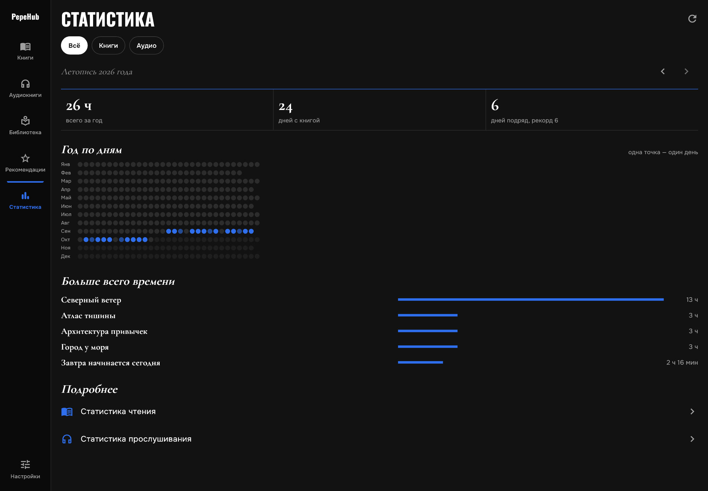</a></td>
</tr>
<tr>
<td width="50%" align="center"><b>Подборки книг</b> <a href="docs/screenshots/recommendations.png">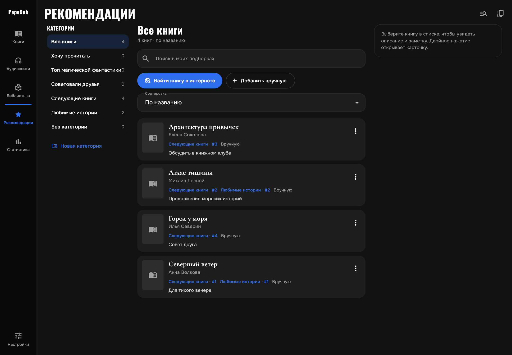</a></td>
<td width="50%" align="center"><b>Библиотека</b> <a href="docs/screenshots/obsidian.png">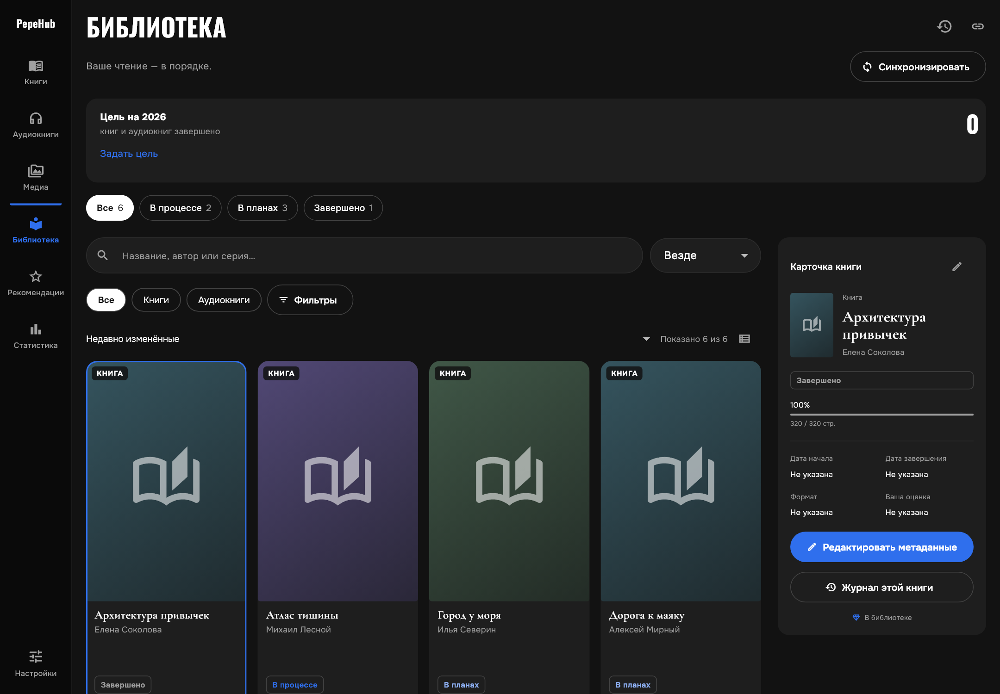</a></td>
</tr>
<tr>
<td colspan="2" align="center"><b>Статистика музыки</b> <a href="docs/screenshots/music-statistics.png">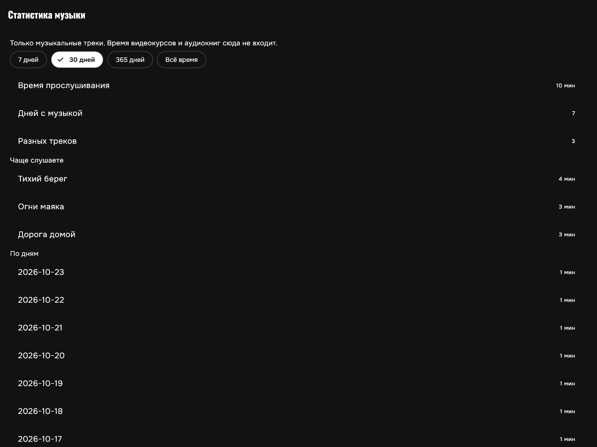</a></td>
</tr>
<tr><td colspan="2" align="center"><b>Оформление и настройки</b> <a href="docs/screenshots/settings.png">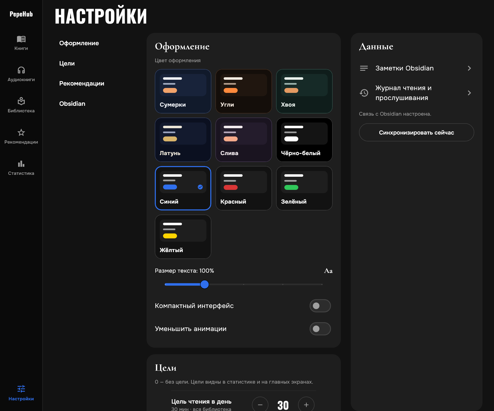</a></td></tr>
<tr>
<td width="50%" align="center"><b>Книги на телефоне</b> <a href="docs/screenshots/books-mobile.png">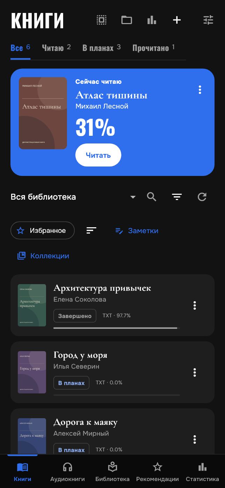</a></td>
<td width="50%" align="center"><b>Музыка на телефоне</b> <a href="docs/screenshots/music-mobile.png">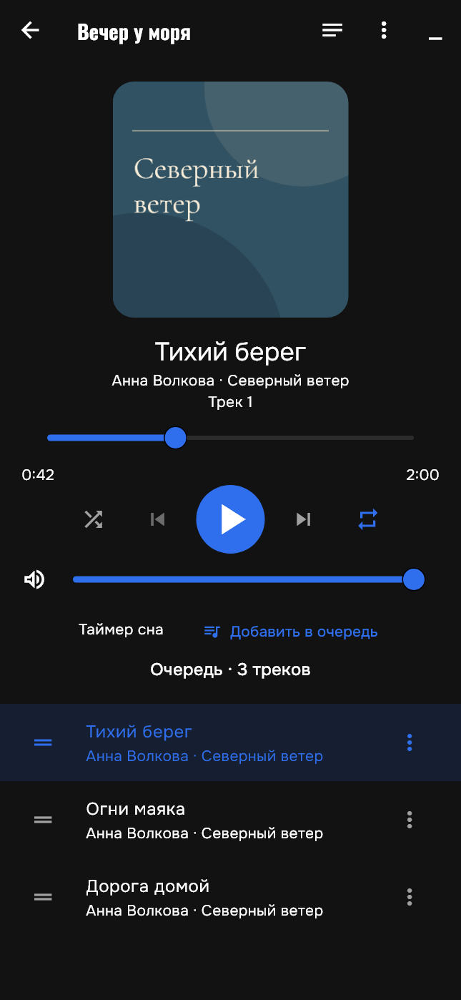</a></td>
</tr>
</table>

## Возможности

Шесть разделов: **Книги · Аудиокниги · Медиа · Библиотека · Рекомендации · Статистика**. На широком экране используется боковая навигация, на узком — мобильная компоновка.

### Библиотека электронных книг

- Импорт файлов или подключение папки без постоянного копирования всей библиотеки. Android использует системный выбор файлов и папок — SAF.
- Извлечение названия, авторов, обложки, серии и номера тома там, где их содержит формат. Обновление сведений из файла и редактирование карточки.
- Поиск и совместные фильтры по статусу, формату, папке, избранному и коллекции. Сортировка по названию, автору, серии, прогрессу и недавней активности.
- Избранное и свои коллекции. Книга может входить в несколько коллекций; удаление коллекции сохраняет книги и историю.
- Карточка книги с позицией, заметками, статистикой и планом чтения.
- Повторный импорт определяется по содержимому. Отключение папки сохраняет заметки и прогресс; независимая импортированная копия остаётся доступной.

### Читалка

- Листание горизонтально или вертикально: вертикальные страницы разделены чертой, разбивку можно отключить, можно читать по главам. Размер шрифта, интервал, поля и выравнивание. Окно оформления открывается поверх книги и сразу показывает изменения на странице.
- Светлая, тёмная, сепия и системная палитры текста; Lora для книжного шрифта и Onest для варианта без засечек.
- Оглавление, поиск по книге, сохранение позиции, переход к заметке. После перехода несколько секунд видна кнопка «Вернуться». Клавиатурная навигация на ПК.
- Текст на весь экран: панели скрыты и появляются поверх страницы по нажатию в центре, не сдвигая текст. Сверху — поиск, оглавление, оформление и меню; внизу — номер страницы «3 из 197» и ползунок. Под текстом — тихая строка с главой и страницей. Настраиваемые действия левой, центральной и правой зон нажатия.
- Локальные сноски EPUB/FB2 поверх текста. Иллюстрации в своих пропорциях встают в страницу вместе с текстом и подписью; нажатие открывает их на весь экран с увеличением.
- Длинная цитата через несколько страниц одной главы с отдельным выбором начала и конца.
- Автоматический учёт активного времени. Фон, открытые панели и бездействие приостанавливают счётчик.

Также доступны: быстрое восстановление позиции в больших книгах, поиск по текущей главе с продолжением выдачи и переходами между совпадениями, системная палитра независимо от темы библиотеки и настройка ширины колонки. Также доступны быстрые цвета выделения с запоминанием выбора, скрытие подсветок, именованные закладки с переименованием и отменой удаления, поиск главы по названию или номеру. [Описание и управление](docs/READER_NAVIGATION_AND_SEARCH.md).

### PDF

- Исходная вёрстка, масштабирование, оглавление и поиск по текстовому слою.
- Цветные цитаты, комментарии и заметки к страницам; переходы по внутренним ссылкам.
- Темы, полный экран, сохранение позиции и альтернативный текстовый режим с настройкой шрифта.
- Общая статистика и планы чтения при наличии извлекаемого текста.

[Возможности PDF и ограничения](docs/PDF_READER_PARITY.md).

### Аудиобиблиотека

- Папки подключаются **без копирования аудиофайлов**. Импорт отдельных файлов с копированием — отдельная команда.
- Предпросмотр найденных книг, естественная сортировка частей по номерам, объединение дисков и пронумерованных частей. Доступны объединение и разделение карточек.
- Несколько треков образуют одну книгу с общей позицией. M4B поддерживает встроенные главы, если они есть в файле.
- Избранное, коллекции, статусы, поиск и фильтры; сортировка по автору, прогрессу, активности и длительности.
- Обложки из файла или папки и выбор своей обложки; сохранение порядка частей.
- Обновление и отключение корней, переименование отображаемого названия. Папку книги можно переименовать или переместить внутри поддерживаемого подключённого корня по явной команде пользователя.

[Устройство каталога](docs/AUDIOBOOK_CATALOG.md) · [Коллекции и сортировка](docs/AUDIOBOOK_ORGANIZATION.md).

### Аудиоплеер

- Общая шкала книги и шкала текущего трека; переходы по трекам и встроенным главам.
- Скорость воспроизведения, перемотки на 10 секунд и минуту, история перемоток с возвратом к исходной позиции.
- Продолжение с сохранённого места; мини-плеер для управления звучащей книгой из других разделов.
- Таймер сна на время, до конца главы или трека; плавное затухание, возврат на 10 секунд после сна и продление таймера.
- Закладки и заметки к позиции: мысль, цитата или персонаж. Редактирование, удаление и восстановление удалённых закладок.
- Фоновое воспроизведение, системные медиакнопки Android, обработка аудиофокуса и отключения наушников. Декодирование зависит от формата и платформенного движка.

[Плеер](docs/AUDIOBOOK_PLAYER_091.md) · [Заметки и мини-плеер](docs/AUDIOBOOK_NOTES_MINIPLAYER_093.md) · [Android-медиакнопки](docs/ANDROID_MEDIA_CONTROLS.md).

### Музыка

В **Медиа → Музыка** есть отдельный плеер и музыкальная статистика. Аудиокниги остаются в своём разделе.

- Музыкальные файлы, папки с треками и прямые HTTP(S)-ссылки; поиск по названию, исполнителю и альбому после чтения тегов.
- Название, исполнитель, альбом и номер трека. Доступные теги читаются при открытии; сведения можно изменить без перезаписи аудиофайла.
- Встроенные обложки ID3, MP4/M4A и FLAC; на Android SAF — также системное извлечение. При отсутствии встроенной картинки проверяется соседняя обложка.
- Перемешивание, повтор одного трека и всего плейлиста, предыдущий/следующий трек.
- **Играть следующим**, перетаскивание и удаление из очереди, возврат треков через **Добавить в очередь**. Порядок файлов библиотеки не меняется.
- Восстановление очереди, текущего трека, перемешивания и повтора после перезапуска. Очередь хранится локально на каждом устройстве.
- Перемотка, громкость, таймер сна, мини-плеер, фоновое воспроизведение и системные медиакнопки. Таймер до конца трека имеет приоритет над повтором.
- Отдельные итоги за 7/30/365 дней или всё время: прослушанное время, активные дни и треки. Время музыки не входит в отчёты видеокурсов.

[Импорт, управление и ограничения музыки](docs/MEDIA_MUSIC.md).

### Видео, курсы и обучение

В **Медиа → Видео и курсы** доступны отдельные файлы, папки с уроками и прямые ссылки на медиа.

- Предварительная проверка порядка уроков, модули, изменение названий, обновление и переподключение папки с сохранением истории.
- Позиция и скорость воспроизведения, полноэкранный режим, мини-плеер и аудиорежим.
- Дорожки звука и субтитров, две строки субтитров, поиск по расшифровке и переход к реплике; возможности зависят от источника.
- A–B-повтор фрагмента с числом повторений и паузами, повтор реплики и история перемоток.
- Заметки с временной привязкой; словарь и карточки Anki из контекста урока. Карточки можно создавать и из текста книги или аудиопозиции.
- Статистика видеокурсов: фактическое время, просмотренные интервалы, повторное изучение и история сессий. Музыкальные треки учитываются отдельно.

[Устройство видеокурсов](docs/VIDEO_SPECIFICATION.md) · [Словарь и экспорт Anki](docs/ANKI_AND_LIBRARY_DEFAULTS.md).

### Цитаты и заметки

- Цветные выделения, исходная цитата и комментарий; теги и персонажи.
- Поиск и комбинированные фильтры по книге, цвету, тегам и персонажам; списки заметок книги и всей библиотеки.
- Редактирование комментария и оформления, удаление с отменой; переход к исходному фрагменту при доступной привязке.
- Экспорт заметок текстовых книг в **Markdown или JSON**.
- Отдельный просмотр заметок карточки библиотеки, в том числе без связанного локального файла.

[Как работать с заметками](docs/READING_NOTES_TOOLS_0101.md).

### Статистика, история и планы

- Общая статистика чтения и прослушивания за год, календарь и основные показатели. Подробные экраны по виду активности и отдельной книге.
- Активное время, дневные цели, серии дней; выбор периода, поиск и фильтрация истории.
- Для текста — новое продвижение, повторное чтение и оценка скорости. Для аудио — звучавшее время, прослушанный объём и повторные интервалы с учётом скорости.
- Просмотр, исправление, добавление и удаление автоматических интервалов и ручных сессий; пересчёт итогов.
- План книги: минуты в день, целевой объём, дата завершения, оценка оставшегося времени и необходимого ежедневного усилия.
- Экспорт статистики в **CSV**, аудиостатистики — также в **JSON**. При недостатке данных скорость и сроки не выдумываются.

Статистика отражает действия в приложении: процент позиции не равен прочитанному объёму, оценка активности не измеряет внимание. [Планы](docs/READING_PLANS_0101.md) · [Учёт чтения](docs/READING_ACTIVITY_0101.md) · [Аудиостатистика](docs/AUDIOBOOK_PROGRESS_STATISTICS_080.md).

### Рекомендации и личные подборки

- Собственные категории и топы; у книги может быть разное место в разных категориях.
- Быстрый выбор подборок из меню книги, команды «Поднять / Опустить» и перетаскивание внутри выбранного топа; сортировки по названию, автору и дате добавления.
- Ручные карточки, личные заметки, поиск по сохранённым названиям, авторам, темам и комментариям.
- Поиск по названию, автору, ISBN или поддерживаемой ссылке в **Inventaire, Open Library и Author.Today**.
- Постепенная выдача результатов, состояния источников, отдельный повтор при ошибке и отметка «Уже в подборках».
- Аннотации, авторы, серии, языки, издания, темы и обложки — в пределах данных выбранного источника.
- Просмотр полной карточки на телефоне с отдельной кнопкой редактирования; понятные пустые состояния и сброс поискового фильтра.
- Дополнение пустых полей с сохранением ручных исправлений; настройка источников и копирование подборок в JSON.

Подборки хранятся локально; сеть нужна для поиска, дополнения сведений и внешних обложек. Это инструмент собственного выбора, а не обещание автоматического рекомендательного алгоритма. [Инструкция](docs/BOOK_RECOMMENDATIONS.md).

### Оформление

- Десять цветовых стилей основного тёмного интерфейса, масштаб текста, компактность и уменьшение анимаций.
- Независимые настройки читалки, дневные цели чтения и прослушивания.
- Выбор источников рекомендаций.
- Onest, Oswald, Cormorant Garamond и Lora включены в приложение и доступны без сети. [Шрифты и лицензии](apps/pepehub/assets/fonts/README.md).

## Поддерживаемые форматы

| Тип | Форматы | Особенности |
|---|---|---|
| Книги | **EPUB, FB2, FB2.ZIP** | Главы, метаданные и обложки; поддерживаемые локальные сноски и иллюстрации. |
| Текст и документы | **TXT, Markdown, HTML, DOCX, RTF** | Чтение извлечённого текста; полная исходная вёрстка поддерживается не для всех форматов. |
| PDF | **PDF** | Исходная вёрстка и текстовый режим; поиск и цитирование требуют текстового слоя. |
| Аудиокниги | **MP3, M4B, M4A, AAC, OGG, Opus, FLAC, WAV** | Отдельные файлы и многотрековые книги; встроенные главы M4B при наличии. |

Пределы: 64 МиБ для книги, 256 МиБ для PDF, 8 ГиБ на файл аудиоимпорта. Для разобранного текста и архивов действуют дополнительные ограничения. Поддержка расширения не гарантирует чтение любого повреждённого или нестандартного файла. [Форматы, кодировки и точные ограничения](docs/FORMATS.md).

## Хранение данных и работа офлайн

| Данные | Где и как хранятся |
|---|---|
| Карточки, позиции, заметки, коллекции, планы, статистика | Локальная SQLite-база приложения. |
| Импортированный файл | Независимая копия в данных приложения; исходник сохраняется. |
| Подключённая папка | Ссылки на оригиналы. Перемещение папки или отзыв SAF-доступа может потребовать повторного подключения. |
| Открытая текстовая книга из Android SAF | При необходимости создаётся проверяемый локальный кеш для читалки. |
| Подключённые журналы и аудиоснимки | Служебные файлы `.pepehub` в выбранной папке с предусмотренными данными для восстановления. |

Чтение, прослушивание доступных файлов, локальные заметки и статистика работают офлайн. Сеть используется только для обновлений и обращения к внешним книжным источникам.

Журналы и аудиоснимки **не являются полной резервной копией базы**: все настройки, коллекции, планы и заметки не гарантированно восстанавливаются только из `.pepehub`. Не очищайте данные приложения для обычного обновления. Новые аудиожурналы версии 2 требуют актуального приложения. [Аудиожурналы](docs/AUDIOBOOK_COMPACT_LOGS_092.md) · [Резервные снимки](docs/AUDIOBOOK_COVERS_BACKUPS.md).

## Каталог настроек

Шесть групп: **Оформление**, **Чтение и аудио**, **Файлы и библиотека**, **Каталоги и инструменты**, **Обновления**, **Помощь и диагностика**. На телефоне — отдельные страницы, на ПК — меню слева. Переключатели сохраняются сразу; кнопка назад возвращает к предыдущему разделу. Мини-плеер остаётся доступен.

Папки полки и папка библиотеки настраиваются отдельно. Технические адреса, источник пакета обновления и подробные журналы доступны по запросу.

## Синхронизация через Syncthing

Встроенной синхронизации в PepeHub нет: папку библиотеки между устройствами переносит [Syncthing](https://syncthing.net/).

1. В Syncthing добавьте одну и ту же папку на телефоне и ПК — `PepeHub-library` или папку, в которой она лежит.
2. В игнорируемых шаблонах этой папки добавьте строку `.pepehub*` — так называются временные файлы записи.
3. На каждом устройстве выберите эту папку в **Настройки → Резервные копии и экспорт → Папка библиотеки**.

Через папку переносятся карточки, история чтения и прослушивания, заметки и обложки. Если оба устройства изменили библиотеку, PepeHub объединяет правки сам; выбирать версию нужно, только если одну карточку изменили по-разному. Файлы книг и аудио в папку библиотеки не входят: держите их в отдельной папке Syncthing и подключите её как источник книг на каждом устройстве. [Формат папки библиотеки](docs/library-folder.md).

## Обновления приложения

**Настройки → Обновления → Проверить обновления**. Windows скачивает проверенный пакет и обновляет файлы с перезапуском; Android открывает системную установку APK поверх приложения. Доступны прогресс загрузки, отмена и докачка.

Манифест проверяется подписью Ed25519, пакеты — по размеру и SHA-256; Android дополнительно сверяет сертификат, идентификатор и номер версии. Автоматическая проверка выполняется не чаще раза в 12 часов, ручная кнопка проверяет сразу. Установка начинается по действию пользователя.

Для старых сборок без механизма обновления новый пакет нужно установить вручную один раз. **Не удаляйте приложение и не очищайте его данные для обычного обновления.** [Установка, защита и восстановление](docs/APP_UPDATES.md).

## Ограничения

- Нет OCR: для PDF-сканов нужен внешний текстовый слой. DRM, MOBI/AZW, DjVu и старый DOC не поддерживаются.
- EPUB не воспроизводит всю CSS-вёрстку; DOCX/RTF открываются как текст, без точного исходного оформления. Длинная цитата ограничена одной главой.
- URL должен вести к доступному медиаисточнику; ссылка на страницу видеосервиса сама по себе не гарантирует воспроизведение.
- Кодеки, аудиофокус и фоновые ограничения требуют проверки на конкретном устройстве. Рендер мобильного интерфейса не заменяет аппаратный тест.
- Служебные журналы не заменяют полную резервную копию. Объёмы предельных библиотек и выигрыш от оптимизаций отдельно не измерялись.

## Для разработчиков

### Стек и структура

**Flutter / Dart** — приложение; **SQLite / Drift** — локальные данные; **TypeScript / Node.js** — скрипты публикации обновлений и их проверки.

~~~text
apps/pepehub/           Flutter-приложение, Android и Windows
  lib/reader/          Читалка, PDF, заметки, учёт и планы
  lib/audio/           Каталог, главы, журналы и аудиостатистика
  lib/library/         Личная библиотека, журналы, обложки и папка библиотеки
  lib/recommendations/ Личные подборки и книжные источники
  lib/media/           Файлы, SAF, аудиоконтроллер и восстановление
  lib/music/           Музыкальный экран, метаданные и статистика
  lib/video/           Курсы, медиасеанс, субтитры и обучение
  lib/storage/         Доступ к выбранным папкам (Windows и Android SAF)
  lib/ui/              Экраны, оформление и адаптивная навигация
scripts/               Сборка, выпуск и публикация обновлений
tests/                 Проверки скриптов обновления (TypeScript)
docs/                  Инструкции, скриншоты и история выпусков
~~~

Проект собирается с **Flutter 3.47.3 / Dart 3.13.3**; эта же версия используется в CI. Для Windows нужен C++ toolchain Visual Studio, для Android — Android SDK/NDK и JDK. Скрипты обновлений и их тесты используют **Node.js 24+**. [Зависимости приложения](apps/pepehub/pubspec.yaml) · [Зависимости скриптов](package.json).

### Запуск и сборка

Пошаговая инструкция для подготовленного Windows-компьютера: [как собрать Windows/Android и опубликовать релиз](docs/BUILD_AND_RELEASE.md).

Из корня репозитория:

~~~powershell
Push-Location apps/pepehub
flutter pub get
flutter run -d windows

# Windows release: build/windows/x64/runner/Release
flutter build windows --release

# Android ARM64 release
flutter build apk --release --target-platform=android-arm64 --split-per-abi
Pop-Location
~~~

Для подготовленной среды `.tools` есть `./scripts/build-android.ps1`: он проверяет подпись, версию, ABI, выравнивание и аудиоресурсы, создаёт пакет в `dist`. [Android-среда и подпись](docs/ANDROID.md). Для обычной работы приложения локальный API не нужен.

Локальные кнопки `.local/claude-check.cmd` и `.local/claude-android.cmd` используют общий `scripts/run-local-build.ps1`: подготовка зависимостей, анализ, тесты, сборка и открытие результата после успеха. [Порядок запуска и логи](docs/LOCAL_BUILDS.md).

### Проверки

Все проверки одной командой, без сборки: `scripts\test.cmd` (варианты — `-AnalyzeOnly`, `-Android`, пути отдельных тестов). Коммит с отправкой: `scripts\commit.cmd`. Список команд — в `КОМАНДЫ.txt`. Вручную то же самое:

~~~powershell
npm ci
npm test
npm run typecheck

Push-Location apps/pepehub
flutter analyze
flutter test
Pop-Location
~~~

Те же шаги выполняет CI на каждый push в `main` (`.github/workflows/tests.yml`). Нативные Android-тесты (JVM/Robolectric) запускаются отдельно: `scripts\test.cmd -Android` или при выпуске. Автоматические проверки не заменяют аппаратную проверку телефона.

Как обновить скриншоты README

Основные книжные экраны можно переснять включаемым вручную рендерером реальных виджетов. Данные синтетические, база в памяти, внешние сервисы не используются. Обычный прогон пропускает этот сценарий.

~~~powershell
Push-Location apps/pepehub
$env:PEPEHUB_README_SCREENSHOTS = '1'
flutter test test/readme_screenshots_test.dart
Remove-Item Env:PEPEHUB_README_SCREENSHOTS
Pop-Location
~~~

PNG сохраняются в `docs/screenshots/`. Перед публикацией проверьте каждое изображение и обновите подписи при изменении интерфейса.

## Документация

| Тема | Материалы |
|---|---|
| Начало работы | [Быстрый старт](docs/GETTING_STARTED.md), [Android](docs/ANDROID.md) |
| Чтение | [Читалка](docs/READER_010.md), [форматы](docs/FORMATS.md), [PDF](docs/PDF_READER_PARITY.md) |
| Заметки и планы | [Инструменты заметок](docs/READING_NOTES_TOOLS_0101.md), [планы](docs/READING_PLANS_0101.md), [Anki и папки по умолчанию](docs/ANKI_AND_LIBRARY_DEFAULTS.md) |
| Аудиокниги | [Каталог](docs/AUDIOBOOK_CATALOG.md), [папки без копирования](docs/AUDIOBOOK_LINKED_FOLDERS.md), [многотрековый режим](docs/AUDIOBOOK_MULTITRACK.md) |
| Подборки | [Рекомендации](docs/BOOK_RECOMMENDATIONS.md) |
| Музыка и видеокурсы | [Музыка](docs/MEDIA_MUSIC.md), [видеокурсы](docs/VIDEO_SPECIFICATION.md), [проверки 0.22.0](docs/MUSIC_SYNC_PERFORMANCE_VALIDATION.md) |
| Папка библиотеки и Syncthing | [Формат и синхронизация](docs/library-folder.md) |
| Обновления приложения | [Windows/Android, установка и публикация выпусков](docs/APP_UPDATES.md) |
| Разработка и выпуски | [Архитектура](ARCHITECTURE.md), [сборка и выпуск](docs/BUILD_AND_RELEASE.md), [проверки](docs/VALIDATION.md), [заметки выпусков](docs/releases/) |

Часть документов описывает исторические этапы; актуальный состав выпуска указан в release notes. Не добавляйте в Git личные книги, базу приложения, токены, ключи подписи и содержимое `.local`/`.tools`.
